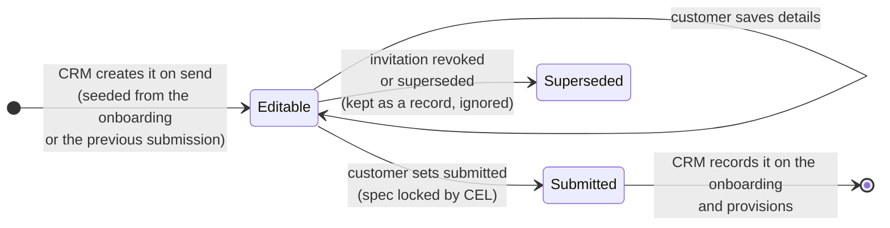
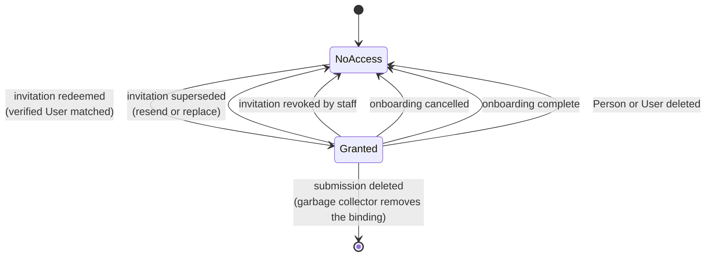
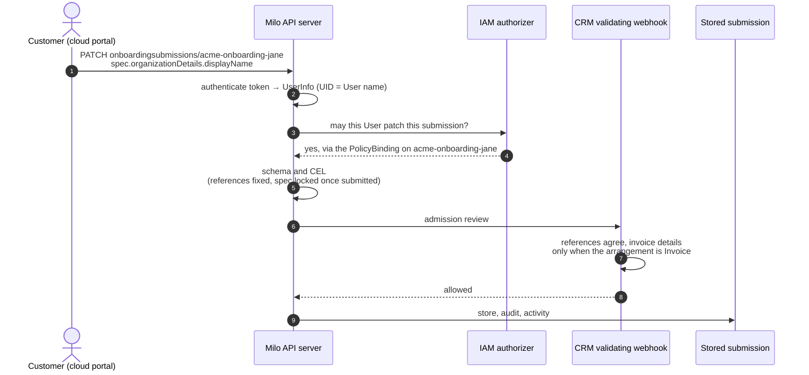
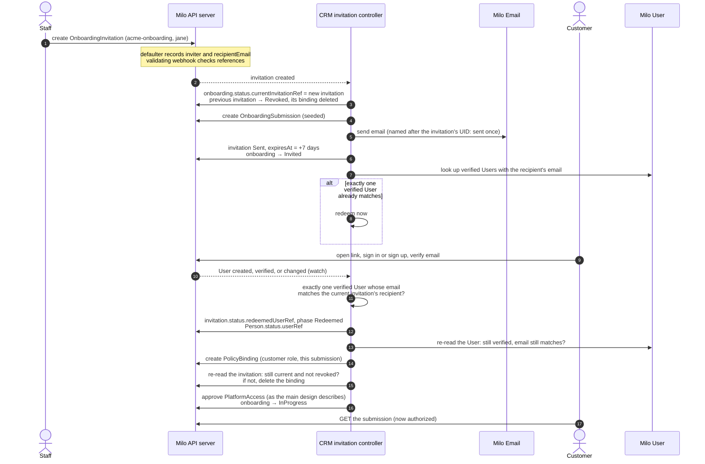
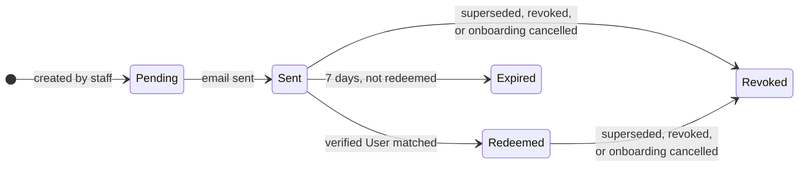

# Onboarding actions and customer access

**Status:** Proposed. Tracked in [#12](https://github.com/milo-os/crm/issues/12). It becomes Accepted when reviewers agree and item 1 of [To verify with Milo](#to-verify-with-milo) has been run.

**Applies to:** [Opportunity-led onboarding design](opportunity-led-onboarding.md). This document replaces that design's thin server-side action API and its invitation secret and verifier. See [What changes in the main design](#what-changes-in-the-main-design).

## Summary

Every onboarding action is a write to a CRM resource. There is no separate action API server.

- **Staff** send, resend, and replace an invitation by creating an `OnboardingInvitation`. They cancel with a field on the invitation or the onboarding.
- **The customer** never touches the onboarding. CRM gives each invitation an `OnboardingSubmission` *(new)*, a record the customer owns. The customer saves details and submits by updating it, and CRM takes the submitted record as final.

Milo checks every request before CRM sees it: authentication, IAM authorization, and audit. Because staff and the customer write **different records**, IAM alone decides who can change what. No webhook has to work out whether a request comes from staff or the customer. CRM then:

1. **Records who acted** with a defaulting webhook: the inviter and who authorized invoicing come from the authenticated request, never from the request body.
2. **Carries out the work** with controllers. They send the email, grant and revoke the customer's access to their submission with a Milo `PolicyBinding`, and provision the organization.

The invitation link carries no secret. The customer gets access because their **verified email matches the invitation**, the same model Milo's own `UserInvitation` uses.

## Context

The onboarding has two kinds of actor with different needs:

| Actor | Actions | Must not |
|---|---|---|
| Staff (Milo staff with the CRM admin role) | prepare, send, resend, replace, cancel an invitation, cancel the onboarding, authorize Invoice billing | change or submit what the customer enters |
| Customer (the invited person, once signed in) | open their onboarding, save details, submit | see other CRM records; change billing terms; send or cancel |

The decision has to answer four questions:

1. **How are actions performed?**
2. **How does the customer reach only their own onboarding**, and only the fields meant for them?
3. **How is the acting person recorded**, so the record can't be forged?
4. **How is a retried action recognized**, so it never sends two emails or creates two invitations?

Plus: **does the invitation link need a secret, and does redeeming it need its own session?**

## Options considered

| Option | How it works | For | Against |
|---|---|---|---|
| **A. Aggregated API server** | CRM runs its own API server in a separate group (for example `actions.crm.miloapis.com`). Each action is an endpoint such as `POST …/onboardings/acme/send`, and the customer reads a trimmed view | handlers see the caller; exact customer view and per-field control | a second server to run (APIService registration, TLS, delegated authentication and authorization); retries need request IDs and somewhere to store them; imperative actions that reconciliation must agree with |
| **B. CRDs, customer input in its own resource** (chosen) | staff write the onboarding and invitations; the customer writes only an `OnboardingSubmission` that CRM creates for their invitation; CRM takes it as final on submit | nothing new to run; Milo authentication, authorization, audit, and activity apply unchanged; IAM separates staff from the customer; retries safe by design; declarative | one more CRD |

### Why B

B gives everything the issue asks for, with the least to build and operate:

- Requests pass through Milo authentication, authorization, and audit by construction.
- Who may change what is decided by IAM, per record. There are no requester-aware webhook rules to get wrong.
- Retries are idempotent.
- There is no credential to protect.

## Actions

| Action | Who | How | What CRM does |
|---|---|---|---|
| Send | Staff | create an `OnboardingInvitation` for the onboarding and a Person | record the inviter and recipient email; create the invitation's submission; make it the current invitation; email the link; move the onboarding to `Invited` |
| Resend | Staff | create another invitation for the same Person | as send; revoke the previous invitation |
| Replace | Staff | create an invitation for a different Person | as resend; the previous recipient loses access |
| Cancel invitation | Staff | set `spec.revoked: true` *(new)* on the invitation | revoke the recipient's access; keep the onboarding for a later invitation |
| Cancel onboarding | Staff | set `spec.cancelled: true` *(new)* on the onboarding | revoke every invitation and access; move to `Cancelled`, which is final |
| Redeem | nobody | automatic: the recipient signs in with the verified invited email | grant the customer access to their submission only |
| Save details | Customer | update their `OnboardingSubmission` | nothing; IAM and CEL decide what is allowed |
| Submit | Customer | set `spec.submitted: true` *(new)* on their submission | take the submission as final; move to `Completing`; provision (#15) and complete (#16) |

Fields and kinds marked *(new)* don't exist yet; [What changes in the API](#what-changes-in-the-api) lists them with the issue that adds them.

Send, resend, and replace are the same action: **create an invitation**. The newest invitation of an onboarding is its current one, and it supersedes the rest. This removes three separate code paths.

CRM decides which invitation is current per onboarding:

1. It lists the onboarding's invitations, reading from the API server rather than its cache, so a just-created invitation isn't missed.
2. It ignores revoked and expired ones.
3. It sorts the rest by `creationTimestamp`, newest first. Timestamps have one-second precision, so two invitations created in the same second are ordered by name; the result is always the same.
4. The newest one is current. CRM records it in `status.currentInvitationRef`, and only ever emails, redeems, or reads the submission of that one.
5. Every older one is marked `Revoked`, with a `Superseded` condition naming the newer invitation, and its binding is deleted. If it had been redeemed, that customer loses access, which is what replacing a recipient means.

**Cancelling never deletes anything.** CRM keeps cancelled onboardings, revoked invitations, and their submissions as records, so staff can see past attempts on an Opportunity, for example "we started onboarding Acme in March, then cancelled it". Staff have no `delete` permission on onboardings, invitations, or submissions. These records only go away when their Company is deleted.

## The customer's submission

An `OnboardingSubmission` holds everything the customer enters, and nothing else.

| Part | Contents | Written by |
|---|---|---|
| `spec.onboardingRef`, `spec.invitationRef` | which onboarding and invitation it belongs to | CRM, on create; immutable |
| `spec.organizationDetails`, `spec.billing.contactInfo`, `spec.billing.taxIds`, `spec.billing.invoice` | the details the customer completes | CRM seeds them; then the customer |
| `spec.submitted` | the customer's final answer | the customer |
| `status` | the agreed currency and payment arrangement and the agreement versions to accept (all for display), validation conditions | CRM |

Because the record contains only customer fields, it **is** the allowlist of what the customer can write. A field added to the onboarding later never becomes customer-readable or customer-writable by accident.

How it works:

- **One per invitation.** CRM's invitation controller creates it when the invitation is sent, named after the invitation, so creating it again is a no-op. It is owned by the invitation, which adds one level to CRM's ownership tree: Company → onboarding → invitation → submission.
- **Seeded, then the customer's.** CRM copies the staff-prepared details from the onboarding into the first submission. A resend or replacement seeds the new submission from the previous one instead, so the customer's corrections carry over. Agreement acceptance never carries over: the new recipient submits, and so accepts, for themselves.
- **The onboarding's details are locked once sent.** The customer's working copy is the submission, so staff changes after send would never reach it. Once sent, staff read the submission, and the customer makes any corrections.
- **CRM locks before it seeds.** When the first invitation is sent, CRM moves the onboarding to `Invited` before creating the submission from its details. The details are then locked by the time they're copied, so no staff edit can land between the copy and the lock and be missed by the customer's submission.
- **Locked on submit, not on a phase change.** A CEL rule on the submission makes its whole spec immutable once `spec.submitted` is `true`, in the same write. There is no window between "submitted" and CRM moving the onboarding's phase.
- **The customer can't choose the agreement versions.** CRM puts the versions to accept in the submission's status. Submitting accepts the versions shown there, and CRM records exactly those.
- **Submitting:** CRM checks that the submission belongs to the onboarding's current invitation and that the invitation is redeemed. It then records on the onboarding's status the submission (`submissionRef`), the submitter, the time, and the accepted agreement versions, and moves the onboarding to `Completing`. The locked submission is the snapshot that provisioning (#15) reads. A submission of a superseded invitation is ignored.
- **Invoice details** are only accepted when the onboarding's payment arrangement is Invoice. A validating webhook checks this, since CEL can't read the onboarding. It is a reference check, not a check on who is asking.



## Authorization

There are four layers, each with one job:

| Layer | Question it answers | Mechanism |
|---|---|---|
| IAM | May this User write this kind of record, or this one record, at all? | Milo Roles and PolicyBindings |
| Schema (CEL) | Can this field change now? | immutability, the lock on submit, and the onboarding's phase locks |
| Validating webhook | Do the references agree? | `internal/validation/crm` |
| Defaulting webhook | Who did this? | records `UserInfo.UID` into the action's field |

Both webhooks are registered with `failurePolicy: Fail`, so if CRM can't answer, the request is refused.

### Roles

| Role | Bound to | Grants |
|---|---|---|
| `crm.miloapis.com-admin` (existing, changed) | staff, platform-wide | all CRM records, plus **creating invitations** and **updating them to revoke**. Today invitations are left out on purpose; this design adds them, since creating one is the send action. **Read-only on submissions.** It **loses `delete` on onboardings**, and never gets it on invitations or submissions, so cancelled records are kept. |
| `crm.miloapis.com-viewer` (existing, extended) | staff | read all CRM records, including submissions |
| `crm.miloapis.com-onboarding-customer` *(new)* | one customer, on **one submission** | `onboardingsubmissions` `get`, `update`, `patch`. No `list`, `watch`, `delete`, or status, and nothing on any other kind. |

Staff never get status write permission. Customers never get `list`: an instance binding lets them read their own submission by name, never discover others.

### The customer's PolicyBinding

When a customer redeems an invitation, CRM's controller creates one PolicyBinding. It follows the shape Milo's own `UserInvitation` controller uses:

```yaml
apiVersion: iam.miloapis.com/v1alpha1
kind: PolicyBinding
metadata:
  name: crm-onboarding-<invitation-uid>     # deterministic: one per invitation
  namespace: <CRM's platform IAM namespace> # where CRM's roles live
  labels:
    crm.miloapis.com/onboarding: acme-onboarding
    crm.miloapis.com/invitation: acme-onboarding-jane
spec:
  roleRef:
    name: crm.miloapis.com-onboarding-customer
    namespace: <CRM's platform IAM namespace>
  subjects:
    - kind: User
      name: "340583683847097153"            # the redeemer's User name (= UserInfo.UID)
      uid: 9b2f…                            # the User's metadata.uid
  resourceSelector:
    resourceRef:                            # this one submission, nothing else
      apiGroup: crm.miloapis.com
      kind: OnboardingSubmission
      name: acme-onboarding-jane
      uid: 5c1d…
```

- **One binding per invitation,** named after the invitation's UID. Creating it twice is a no-op, and revoking the invitation means deleting exactly that binding.
- **`roleRef` and `resourceSelector` are immutable in Milo.** A binding never moves to another submission or role; a new invitation always gets a new binding.
- **Deleting the submission removes it automatically.** Milo's `PolicyBindingAdopter` makes the binding owned by the record its `resourceRef` names, so the garbage collector deletes it with the submission, for example when the Company is deleted. CRM deletes it in every other case; see [Access lifecycle](#access-lifecycle).
- **CRM creates it from platform context.** Milo's PolicyBinding webhook restricts bindings created inside an organization to that organization's Projects and itself. CRM's binding is created at platform scope, which that webhook doesn't restrict. Item 1 of [To verify with Milo](#to-verify-with-milo) confirms the whole path works for a customer.

### Access lifecycle



A binding exists only while its invitation is redeemed and current. Every way it ends:

| Scenario | What triggers it | Who deletes the binding | When |
|---|---|---|---|
| Invitation superseded | staff create a newer invitation for the onboarding (resend or replace) | CRM's invitation controller | when it revokes the older invitation |
| Invitation revoked | staff set `spec.revoked: true` on it | CRM's invitation controller | when it marks the invitation Revoked |
| Onboarding cancelled | staff set `spec.cancelled: true` on the onboarding | CRM's invitation controller | when it revokes the onboarding's invitations, before the onboarding becomes `Cancelled` |
| Onboarding complete | CRM finishes provisioning (#16) | CRM's completion controller | after the customer's organization membership exists, so they always have access to one or the other |
| Person deleted | staff delete the invitation's Person | CRM's Person finalizer (#13) | when it revokes the Person's invitations, before the Person is removed |
| User deleted | the redeemed Milo User is deleted | CRM's redemption controller, which already watches Users | when it sees the deletion; the binding's subject UID no longer matches anyone, so it grants nothing until then |
| Submission deleted | staff delete the Company (no one deletes submissions directly) | Milo's garbage collector | with the submission, through the owner the `PolicyBindingAdopter` sets |

Two cases never have a binding to delete: an invitation that **expires** was never redeemed, and a **submitted** onboarding keeps its binding until it completes, so the customer can still follow its progress. CEL already stops them changing anything.

**A binding that outlives its invitation is harmless.** Until CRM deletes it, or if deleting it fails and is retried, a replaced customer can still edit only their own submission. CRM no longer reads that submission, because it belongs to a superseded invitation. Nothing they write reaches the onboarding, and they can't cancel it, because they have no access to it.

### What a request looks like

A customer saving details:



A staff member making the same request is refused by IAM: staff roles can only read submissions. The customer can't write the onboarding at all.

## Recording who acted

IAM can say *whether* a User may write, but nothing records *who* did. CRM's defaulting webhook, the same one that sets owner references, records the requester's `UserInfo.UID`, which is the Milo User's name, into the field that belongs to the action. It **overwrites** any value the client sent, so attribution can't be forged:

| When | Field recorded | Kept where |
|---|---|---|
| An invitation is created (send, resend, replace) | the inviter | the invitation's `spec.inviterRef` *(new)*; immutable, like the rest of its spec |
| `paymentArrangement` becomes `Invoice` while in Draft | who authorized invoicing, and when | the onboarding's billing; cleared if switched back to Card; locked once sent |

These fields live in spec, not status, because a defaulting webhook can only change what the request writes, and a spec write can't write status. CEL keeps them immutable, and the defaulter is their only writer. As a backstop, the validating webhook rejects a request whose recorded identity doesn't match the requester, so a missing or misconfigured defaulter fails closed instead of storing the client's value. `spec.inviterRef` replaces today's `status.inviterRef`: the inviter is recorded when staff create the invitation, and status can't be written on create, so it has no status copy.

**The submitter needs no recording.** Only one User can write a submission: its invitation's redeemer, through the binding. When the submission is submitted, CRM records that redeemer as the submitter on the onboarding.

The same defaulter also **fills in the invitation's `recipientEmail`** from the Person when staff leave it empty. The validating webhook still requires it to match the Person.

## Redemption without a secret

The link in the email only names the recipient's submission, which shares the invitation's name, for example `https://cloud.datum.net/onboarding/acme-onboarding-jane`. It grants nothing. Access comes from the email match:



- **Redeeming** means the verified User is recorded on the current invitation and gets the binding. It happens as soon as the match exists, whether the User signed up after the email or already existed.
- **The email must be verified.** The redemption check (`redeemerMatches`, enforced by the #11 webhook) requires `status.emailVerification: Verified`. Milo's email-verification enforcement is off by default, so being signed in alone is not enough.
- **Emails are matched ignoring case.** Milo doesn't normalise `User.spec.email`, so a field selector can miss a User whose stored email has different case. CRM keeps its own index of Users by lower-cased email, as Milo's `UserInvitation` controller does, and compares both sides lower-cased.
- **Exactly one User must match.** If more than one verified User has the recipient's email, CRM doesn't guess. It redeems no one and sets a condition on the invitation for staff to resolve.
- **The match is checked again before access is granted.** Just before creating the binding, CRM re-reads the User from the API server and confirms it is still verified and its email still matches. A User who changes their email before redemption stops matching, and the match is made afresh against whoever holds the email then.
- **After redemption, access follows the User, not the email.** The binding names the User by UID. If they change their email afterwards, they keep access to their submission.
- **Revoking can't race redeeming.** After creating the binding, CRM re-reads the invitation from the API server. If staff revoked or superseded it in the meantime, CRM deletes the binding at once. Even before that, the binding only reaches a submission CRM no longer reads.
- **No credential exists.** Nothing needs storing as a verifier, nothing can leak into logs or status, and there is no session to issue: the Milo session is the session.
- **The portal waits until access exists.** If the customer opens the link before redemption completes, the portal gets `403` on the submission. It shows "setting up your access" and retries until the binding exists.

## Retries and idempotency

Every action is a desired state, so repeating it changes nothing:

| Action | Why a retry is harmless |
|---|---|
| Send, resend, replace | the client chooses the invitation's name; creating it again returns `AlreadyExists` |
| Revoke, cancel, submit | setting a field to the value it already has is a no-op; CEL keeps `true` from going back to `false` |
| Save details | an ordinary update, protected by `resourceVersion` against lost writes |
| Submission | named after the invitation; creating it again is `AlreadyExists` |
| Email | the Email resource is named after the invitation's UID, so the controller creates it at most once |
| PolicyBinding | named after the invitation's UID; creating it again is `AlreadyExists` |

There is no request-ID store; the records themselves carry the state. This meets the issue's "a repeated request with the same identifier is recognized as a retry". The identifier is the invitation's name, or the record and field itself.

## Invitation lifecycle

The onboarding's phases are described in the main design and the API types. The invitation's are new:



## What the customer can see

The customer can read exactly one record: their submission. It holds the details they're completing, and, for display, the agreed currency and arrangement, the agreement versions to accept, and validation conditions. It names its onboarding and invitation, which are internal names, not sales data.

They can't read the onboarding, the Company, Opportunity, People, notes, or anyone else's submission: their role grants nothing else, and there is no `list`.

## Security considerations

The other protections are described where they apply: the links grant nothing, a replaced customer's leftover access reaches nothing CRM reads, attribution can't be forged, and the webhooks fail closed. Two points stand on their own:

- **Email ownership is the trust anchor.** Access requires a verified email equal to the invitation's recipient. A takeover of that mailbox is a takeover of the onboarding, which is the same trust Milo's own invitations place in email.
- **CRM's own identity needs only:**
  - `create`, `get`, and `delete` on PolicyBindings in its namespace;
  - `get`, `list`, and `watch` on Users;
  - `create` on Email;
  - `create` on submissions, and status `update` on its kinds;
  - the PlatformAccess transition the main design describes.

  It never needs `system:masters`, and never impersonates the customer.

## What changes in the API

These changes land with the issues that implement the actions, not in #12:

| Resource | Change | Issue |
|---|---|---|
| `OnboardingSubmission` | new kind: the customer's details, `spec.submitted`, CEL lock on submit; status with the terms and agreement versions to display | #13 creates it on send; #14 the customer journey |
| `OnboardingInvitation` | staff create it; `status.inviterRef` moves to `spec.inviterRef` (recorded by the defaulter, immutable); add `spec.revoked`; `recipientEmail` defaults from the Person | #13 |
| `OrganizationOnboarding` | add `spec.cancelled` (staff only, can't be undone); the details lock once sent, not just the billing terms (a change to the #11 CEL lock) | #13 |
| `OrganizationOnboarding` | status records the submission, submitter, time, and accepted agreement versions | #14 |
| `OrganizationOnboarding` | record the invoice authorizer from the request when Invoice is chosen | #13 |
| Roles | the admin role gains invitation `create` and `update`, reads submissions, and loses onboarding `delete`; the viewer role reads submissions; new `crm.miloapis.com-onboarding-customer` | #13 |
| Webhooks | the defaulter records the inviter and invoice authorizer; the validating webhook checks submissions' references and invoice details | #13, #14 |
| Controllers | invitation (current, submission, email, expiry, revoke), redemption (match, binding, PlatformAccess), submission, cancellation | #13, #14 |

## What changes in the main design

- **API shape:** the "thin Milo-authenticated server-side action API" and its handler table become the action table above. The customer works in their own `OnboardingSubmission`, reached through a binding on that one record, and never touches the onboarding.
- **Who creates invitations:** in #10, CRM created invitations through its actions, and staff could only view them. Staff now create them directly, since creating one is the send action. What made "CRM only" necessary now comes from admission: the webhook checks the onboarding, the Person, and the recipient email, and records the inviter; CEL makes the spec immutable; only CRM writes status.
- **Access and invitation security:** "expiring, revocable invitation credentials … store only a verifier" and "redemption establishes a scoped session" become the email-match model. Expiry and revocation stay, now on the invitation and its binding.

## To verify with Milo

1. **The customer can reach a platform-scoped record (before this is Accepted).** The whole customer path rests on it. On a test cluster, confirm that Milo's authorizer honours a `resourceRef` binding on a platform-scoped CRM kind for a customer's token, and that the cloud portal can call the platform scope with the customer's session.
2. **The namespace for CRM's roles and bindings.** Platform roles and bindings are namespaced in Milo; confirm the namespace CRM's IAM component deploys into.
3. **The PlatformAccess transition** that approves the redeemed User, as the main design's open dependency describes.
