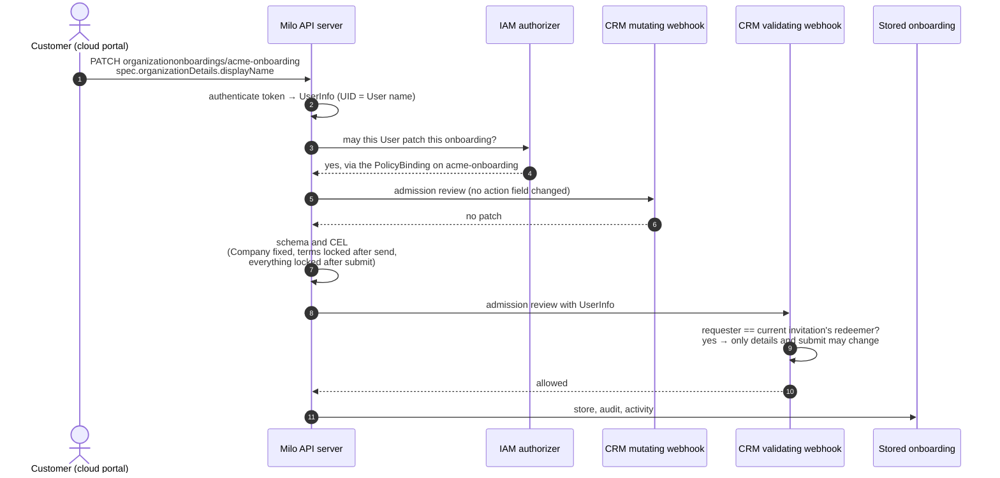
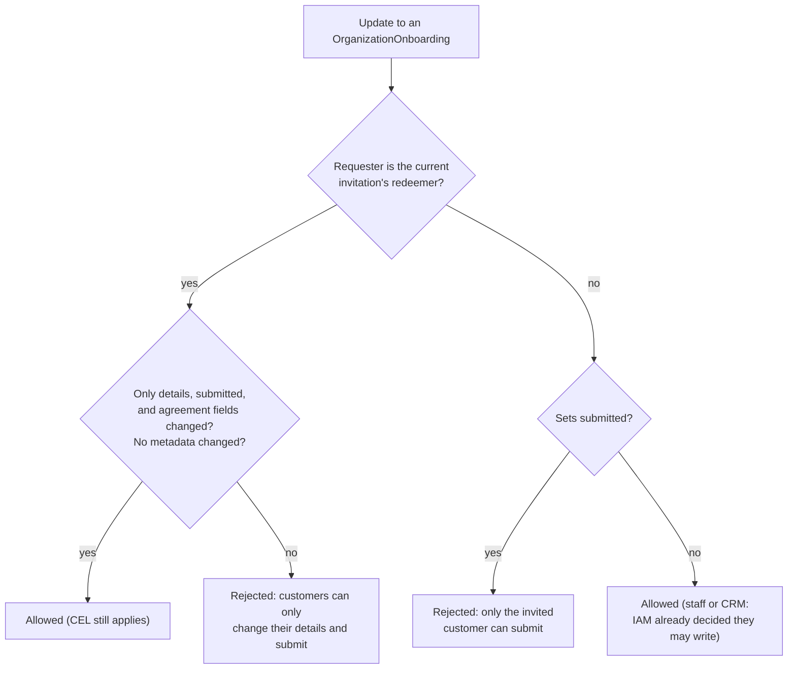
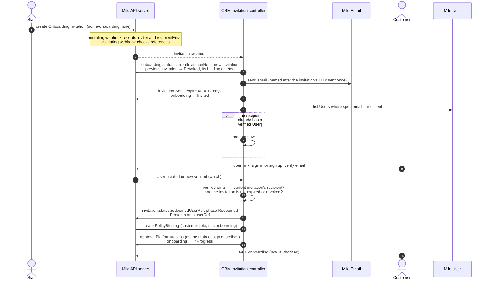
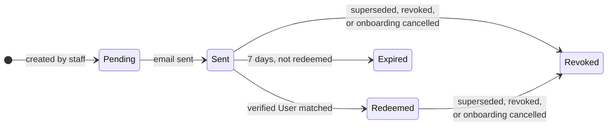

# Onboarding actions and customer access

**Status:** Proposed. Tracked in [#12](https://github.com/milo-os/crm/issues/12); it becomes Accepted when reviewers agree.

**Applies to:** [Opportunity-led onboarding design](opportunity-led-onboarding.md). This document replaces that design's thin server-side action API and its invitation secret and verifier. See [What changes in the main design](#what-changes-in-the-main-design).

## Summary

Every onboarding action is a write to a CRM resource. There is no separate action API server:

- **Staff** send, resend, and replace an invitation by creating an `OnboardingInvitation`. They cancel with a field on the invitation or the onboarding.
- **The customer** saves details and submits by updating their own `OrganizationOnboarding`.

Milo checks every request before CRM sees it: authentication, IAM authorization, and audit. CRM then does three things:

1. **Admission webhooks record who acted.** The inviter, who authorized invoicing, and who submitted come from the authenticated request, never from the request body.
2. **An admission webhook limits what the customer can change** on their onboarding. IAM can't restrict individual fields.
3. **Controllers carry out the work.** They send the email, grant and revoke the customer's access with a Milo `PolicyBinding` on that one onboarding, and provision the organization.

The invitation link carries no secret. The customer gets access because their **verified email matches the invitation**, the same model Milo's own `UserInvitation` uses.

## Context

The onboarding has two kinds of actor with different needs:

| Actor | Actions | Must not |
|---|---|---|
| Staff (Milo staff with the CRM admin role) | prepare, send, resend, replace, cancel an invitation, cancel the onboarding, authorize Invoice billing | submit on the customer's behalf |
| Customer (the invited person, once signed in) | open their onboarding, save details, submit | see other CRM records; change billing terms; send or cancel |

The decision has to answer four questions:

1. **How are actions performed?**
2. **How does the customer reach only their own onboarding**, and only the fields meant for them?
3. **How is the acting person recorded**, so the record can't be forged?
4. **How is a retried action recognized**, so it never sends two emails or creates two invitations?

Plus: **does the invitation link need a secret, and does redeeming it need its own session?**

## Options considered

| Option | How it works | For | Against |
|---|---|---|---|
| **A. Aggregated API server** | CRM runs its own API server in a separate group (for example `actions.crm.miloapis.com`); each action is an endpoint such as `POST …/onboardings/acme/send`, and the customer reads a trimmed view | handlers see the caller; exact customer view and per-field control | a second server to run (APIService registration, TLS, delegated authentication and authorization); retries need request IDs and somewhere to store them; imperative actions that reconciliation must agree with |
| **B. CRDs only** (chosen) | actions are creates and updates of the existing CRDs; IAM decides who may write, webhooks record identity and limit the customer, controllers do the work | nothing new to run; Milo authentication, authorization, audit, and activity apply unchanged; retries safe by design; declarative | the customer reads the whole onboarding ([What the customer can see](#what-the-customer-can-see)); needs requester-aware webhook rules, since IAM can't limit fields |
| **C. Hybrid** | staff as in B; the customer through a small aggregated API | a trimmed customer view, without endpoints for staff actions | the full cost of running a server, for two or three customer operations |

### Why B

B gives everything the issue asks for, with the least to build and operate:

- Requests pass through Milo authentication, authorization, and audit by construction.
- Retries are idempotent.
- There is no credential to protect.

Its one gap, the untrimmed customer view, is small because the onboarding holds no sales data. C stays the fallback if reviewers decide the customer must never see an internal reference name.

## Actions

| Action | Who | How | What CRM does |
|---|---|---|---|
| Send | Staff | create an `OnboardingInvitation` for the onboarding and a Person | record the inviter and recipient email; make it the current invitation; email the link; move the onboarding to `Invited` |
| Resend | Staff | create another invitation for the same Person | make it current, revoke the previous one, email the new link |
| Replace | Staff | create an invitation for a different Person | as resend; the previous recipient loses access |
| Cancel invitation | Staff | set `spec.revoked: true` *(new)* on the invitation | revoke the recipient's access; keep the onboarding for a later invitation |
| Cancel onboarding | Staff | set `spec.cancelled: true` *(new)* on the onboarding | revoke every invitation and access; move to `Cancelled`, which is final |
| Redeem | nobody | automatic: the recipient signs in with the verified invited email | grant the customer access to this onboarding only |
| Save details | Customer | update their onboarding's details | nothing; CEL and the customer-scope rule decide what is allowed |
| Submit | Customer | set `spec.submitted: true` *(new)* and accept the agreements | record who submitted; move to `Completing`; provision (#15) and complete (#16) |

Fields marked *(new)* don't exist yet; [What changes in the API](#what-changes-in-the-api) lists them with the issue that adds them.

Send, resend, and replace are the same action: **create an invitation**. The newest invitation of an onboarding is its current one, and it supersedes the rest. This removes three separate code paths.

CRM decides which invitation is current per onboarding:

1. It lists the onboarding's invitations, reading from the API server rather than its cache, so a just-created invitation isn't missed.
2. It ignores revoked and expired ones.
3. It sorts the rest by `creationTimestamp`, newest first. Timestamps have one-second precision, so two invitations created in the same second are ordered by name; the result is always the same.
4. The newest one is current. CRM records it in `status.currentInvitationRef`, and only ever emails or redeems that one.
5. Every older one is marked `Revoked`, with a `Superseded` condition naming the newer invitation, and its binding is deleted. If it had been redeemed, that customer loses access, which is what replacing a recipient means.

**Cancelling never deletes anything.** CRM keeps cancelled onboardings and revoked invitations as records, so staff can see past attempts on an Opportunity, for example "we started onboarding Acme in March, then cancelled it". Staff have no `delete` permission on onboardings or invitations. These records only go away when their Company is deleted.

## Authorization

There are four layers, each with one job:

| Layer | Question it answers | Mechanism |
|---|---|---|
| IAM | May this User write this kind of record, or this one record, at all? | Milo Roles and PolicyBindings |
| Schema (CEL) | Can this field change now? | immutability and phase locks on the types |
| Validating webhook | Do the references agree, and is the customer staying within their fields? | `internal/validation/crm` |
| Mutating webhook | Who did this? | records `UserInfo.UID` into the action's field |

### Roles

| Role | Bound to | Grants |
|---|---|---|
| `crm.miloapis.com-admin` (existing, changed) | staff, platform-wide | all CRM records, plus **creating invitations** and **updating them to revoke**. Today invitations are left out on purpose; this design adds them, since creating one is the send action. It **loses `delete` on onboardings**, and never gets it on invitations, so cancelled records are kept. |
| `crm.miloapis.com-viewer` (existing) | staff | read all CRM records |
| `crm.miloapis.com-onboarding-customer` (new) | one customer, on **one onboarding** | `organizationonboardings` `get`, `update`, `patch`. No `list`, `watch`, `delete`, or status, and nothing on any other kind. |

Staff never get status write permission. Customers never get `list`: an instance binding lets them read their own onboarding by name, never discover others.

### The customer's PolicyBinding

When a customer redeems an invitation, CRM's controller creates one PolicyBinding. It follows the shape Milo's own `UserInvitation` controller uses:

```yaml
apiVersion: iam.miloapis.com/v1alpha1
kind: PolicyBinding
metadata:
  name: crm-onboarding-<invitation-uid>     # deterministic: one per invitation
  namespace: <CRM's platform IAM namespace> # where CRM's roles live
  labels:
    crm.miloapis.com/onboarding: acme-onboarding
    crm.miloapis.com/invitation: acme-onboarding-jane
spec:
  roleRef:
    name: crm.miloapis.com-onboarding-customer
    namespace: <CRM's platform IAM namespace>
  subjects:
    - kind: User
      name: "340583683847097153"            # the redeemer's User name (= UserInfo.UID)
      uid: 9b2f…                            # the User's metadata.uid
  resourceSelector:
    resourceRef:                            # this one onboarding, nothing else
      apiGroup: crm.miloapis.com
      kind: OrganizationOnboarding
      name: acme-onboarding
      uid: 5c1d…
```

- **One binding per invitation.** It is named after the invitation's UID, so creating it twice is a no-op, and revoking the invitation means deleting exactly that binding.
- **`roleRef` and `resourceSelector` are immutable in Milo.** A binding never moves to another onboarding or role; a new invitation always gets a new binding.
- **Deleting the onboarding removes it automatically.** Milo's `PolicyBindingAdopter` makes the binding owned by the onboarding its `resourceRef` names, so the garbage collector deletes it with the onboarding, including when the onboarding's Company is deleted. CRM deletes it in every other case; see [Access lifecycle](#access-lifecycle).
- **CRM creates it from platform context.** Milo's PolicyBinding webhook only restricts bindings created inside an organization, so CRM's platform-level binding is allowed to target an onboarding.

### Access lifecycle


A binding exists only while its invitation is redeemed and current. Every way it ends:

| Scenario | What triggers it | Who deletes the binding | When |
|---|---|---|---|
| Invitation superseded | staff create a newer invitation for the onboarding (resend or replace) | CRM's invitation controller | when it revokes the older invitation |
| Invitation revoked | staff set `spec.revoked: true` on it | CRM's invitation controller | when it marks the invitation Revoked |
| Onboarding cancelled | staff set `spec.cancelled: true` on the onboarding | CRM's invitation controller | when it revokes the onboarding's invitations, before the onboarding becomes `Cancelled` |
| Onboarding complete | CRM finishes provisioning (#16) | CRM's completion controller | after the customer's organization membership exists, so they always have access to one or the other; from then on they work in their organization |
| Person deleted | staff delete the invitation's Person | CRM's Person finalizer (#13) | when it revokes the Person's invitations, before the Person is removed |
| User deleted | the redeemed Milo User is deleted | CRM's redemption controller, which already watches Users | when it sees the deletion; the binding's subject UID no longer matches anyone, so it is harmless until then |
| Onboarding deleted | staff delete its Company (staff can't delete an onboarding directly) | Milo's garbage collector | with the onboarding, through the owner the `PolicyBindingAdopter` sets |

Two cases never have a binding to delete: an invitation that **expires** was never redeemed, and a **submitted** onboarding keeps its binding until it completes, so the customer can still follow its progress (CEL already stops them changing anything).

The validating webhook also checks the **current** invitation's redeemer on every customer write. So even in the moment before a superseded binding is deleted, a superseded customer can no longer change anything.

### What a request looks like

A customer saving details:



A staff member making the same request passes IAM through their admin role. The customer-scope rule doesn't apply to them, but the submit rule does: staff can't set `spec.submitted`.

## Recording who acted

IAM can say *whether* a User may write, but nothing records *who* did. CRM's defaulting webhook, the same one that sets owner references, records the requester's `UserInfo.UID`, which is the Milo User's name, into the field that belongs to the action. It **overwrites** any value the client sent, so attribution can't be forged:

| When | Field recorded | Kept where |
|---|---|---|
| An invitation is created (send, resend, replace) | the inviter | the invitation's `spec.inviterRef` *(new)*; immutable, like the rest of its spec |
| `paymentArrangement` becomes `Invoice` while in Draft | who authorized invoicing, and when | the onboarding's billing; cleared if switched back to Card; locked once sent |
| `submitted` becomes `true` | who submitted, when, and which agreement versions they accepted | the onboarding's spec; locked with the rest after submit |

These fields live in spec, not status, because a mutating webhook can only change what the request writes, and a spec update can't write status. CEL keeps them immutable, and the defaulter is their only writer. As a backstop, the validating webhook rejects a request whose recorded identity doesn't match the requester, so a missing or misconfigured defaulter fails closed instead of storing the client's value. `spec.inviterRef` replaces today's `status.inviterRef`: the inviter is recorded when staff create the invitation, and status can't be written on create, so it has no status copy.

The same defaulter also **fills in the invitation's `recipientEmail`** from the Person when staff leave it empty, normalized to lower case. The validating webhook still requires it to match the Person.

## The customer's scope

The validating webhook decides whether a request comes from the customer by comparing the requester's `UserInfo.UID` with the redeemer of the onboarding's **current** invitation:



The details the customer may change are `spec.organizationDetails`, `spec.billing.contactInfo`, `spec.billing.taxIds`, `spec.billing.invoice`, plus submitting and accepting agreements. CEL already blocks the Company, the Opportunity, and the billing terms after send, and everything after submit. The webhook adds only the staff-only actions (`cancelled`) and metadata.

## Redemption without a secret

The link in the email only says which onboarding to open, for example `https://cloud.datum.net/onboarding/acme-onboarding`. It grants nothing. Access comes from the email match:



- **Redeeming** means the verified User is recorded on the current invitation and gets the binding. It happens as soon as the match exists, whether the User signed up after the email or already existed.
- **The email must be verified.** The redemption check (`redeemerMatches`, enforced by the #11 webhook) requires `status.emailVerification: Verified`. Milo's email-verification enforcement is off by default, so being signed in alone is not enough.
- **Users are found by email** with a field selector on `spec.email`, a selectable field on Milo Users. This is the same lookup Milo's own invitation controllers index.
- **No credential exists.** Nothing needs storing as a verifier, nothing can leak into logs or status, and there is no session to issue: the Milo session is the session.
- **The portal waits until access exists.** If the customer opens the link before redemption completes, the portal gets `403` on the onboarding. It shows "setting up your access" and retries until the binding exists.

## Retries and idempotency

Every action is a desired state, so repeating it changes nothing:

| Action | Why a retry is harmless |
|---|---|
| Send, resend, replace | the client chooses the invitation's name; creating it again returns `AlreadyExists` |
| Revoke, cancel, submit | setting a field to the value it already has is a no-op; CEL keeps `true` from going back to `false` |
| Save details | an ordinary update, protected by `resourceVersion` against lost writes |
| Email | the Email resource is named after the invitation's UID, so the controller creates it at most once |
| PolicyBinding | named after the invitation's UID; creating it again is `AlreadyExists` |

There is no request-ID store; the records themselves carry the state. This meets the issue's "a repeated request with the same identifier is recognized as a retry". The identifier is the invitation's name, or the record and field itself.

## Invitation lifecycle

The onboarding's phases are described in the main design and the API types. The invitation's are new:



## What the customer can see

With `get` on their onboarding, the customer reads the whole record:

- **Spec:** the organization details and billing they're completing. These are theirs to see.
- **The Company and Opportunity reference names**, for example `acme` and `acme-initial-sale`. These are internal names, not sales data.
- **Status:** phase, conditions, the current invitation's name, and the User who authorized Invoice billing.

They can't read the Company, Opportunity, People, notes, or any other onboarding: their role grants nothing else, and there is no `list`. The onboarding is designed to hold no sales data (notes are ClusterNotes on the Opportunity). If reviewers consider the reference names or the authorizing User sensitive, option C's trimmed view is the remedy.

## Security considerations

The other protections are described where they apply: the links grant nothing, a superseded customer can't write, attribution can't be forged, and the webhooks fail closed. Two points stand on their own:

- **Email ownership is the trust anchor.** Access requires a verified email equal to the invitation's recipient. A takeover of that mailbox is a takeover of the onboarding, which is the same trust Milo's own invitations place in email.
- **CRM's own identity needs only:**
  - `create`, `get`, and `delete` on PolicyBindings in its namespace;
  - `get`, `list`, and `watch` on Users;
  - `create` on Email;
  - status `update` on its kinds;
  - the PlatformAccess transition the main design describes.

  It never needs `system:masters`, and never impersonates the customer.

## What changes in the API

These changes land with the issues that implement the actions, not in #12:

| Resource | Change | Issue |
|---|---|---|
| `OnboardingInvitation` | staff create it; `status.inviterRef` moves to `spec.inviterRef` (recorded by the webhook, immutable); add `spec.revoked`; `recipientEmail` defaults from the Person | #13 |
| `OrganizationOnboarding` | add `spec.cancelled` (staff only, can't be undone) | #13 |
| `OrganizationOnboarding` | add `spec.submitted` and the recorded submitter, time, and accepted agreement versions | #14 |
| `OrganizationOnboarding` | record the invoice authorizer from the request when Invoice is chosen | #13 |
| Roles | the admin role gains invitation `create` and `update` and loses onboarding `delete`; new `crm.miloapis.com-onboarding-customer` | #13 |
| Webhooks | the "who acted" mutating rules; the customer-scope and submit rules | #13, #14 |
| Controllers | invitation (current, email, expiry, revoke), redemption (match, binding, PlatformAccess), cancellation | #13, #14 |

## What changes in the main design

- **API shape:** the "thin Milo-authenticated server-side action API" and its handler table become the action table above. Recipients do access their onboarding directly, through a binding on that one record.
- **Who creates invitations:** in #10, CRM created invitations through its actions, and staff could only view them. Staff now create them directly, since creating one is the send action. What made "CRM only" necessary now comes from admission: the webhook checks the onboarding, the Person, and the recipient email, and records the inviter; CEL makes the spec immutable; only CRM writes status.
- **Access and invitation security:** "expiring, revocable invitation credentials … store only a verifier" and "redemption establishes a scoped session" become the email-match model. Expiry and revocation stay, now on the invitation and its binding.

## To verify with Milo before implementing

1. **The customer can reach a platform-scoped record.** Confirm that Milo's authorizer honours a `resourceRef` binding on a platform-scoped CRM kind for a customer's token, and that the cloud portal can call the platform scope with the customer's session.
2. **The namespace for CRM's roles and bindings.** Platform roles and bindings are namespaced in Milo; confirm the namespace CRM's IAM component deploys into.
3. **Email case.** Field selectors match exactly. Confirm how Milo stores `User.spec.email`, so CRM can normalize `recipientEmail` the same way.
4. **The PlatformAccess transition** that approves the redeemed User, as the main design's open dependency describes.
