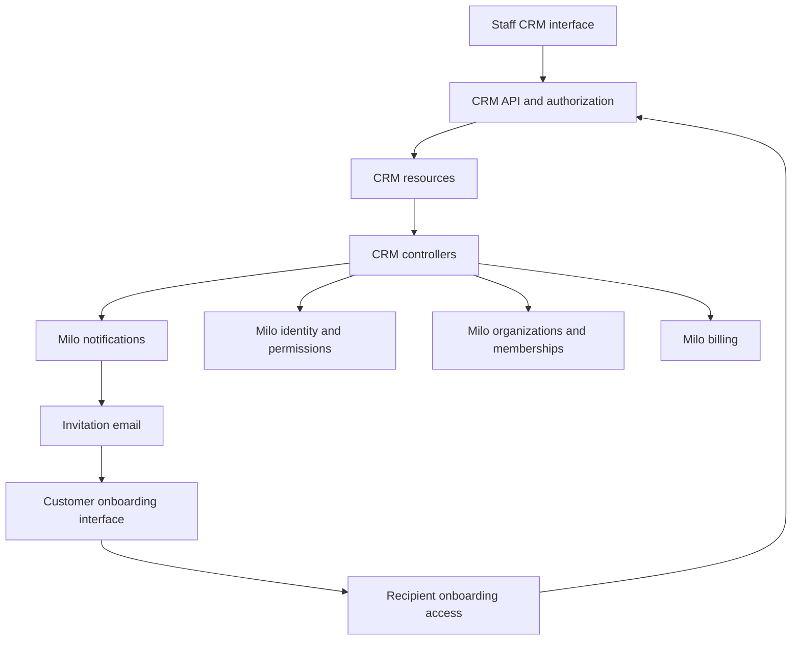
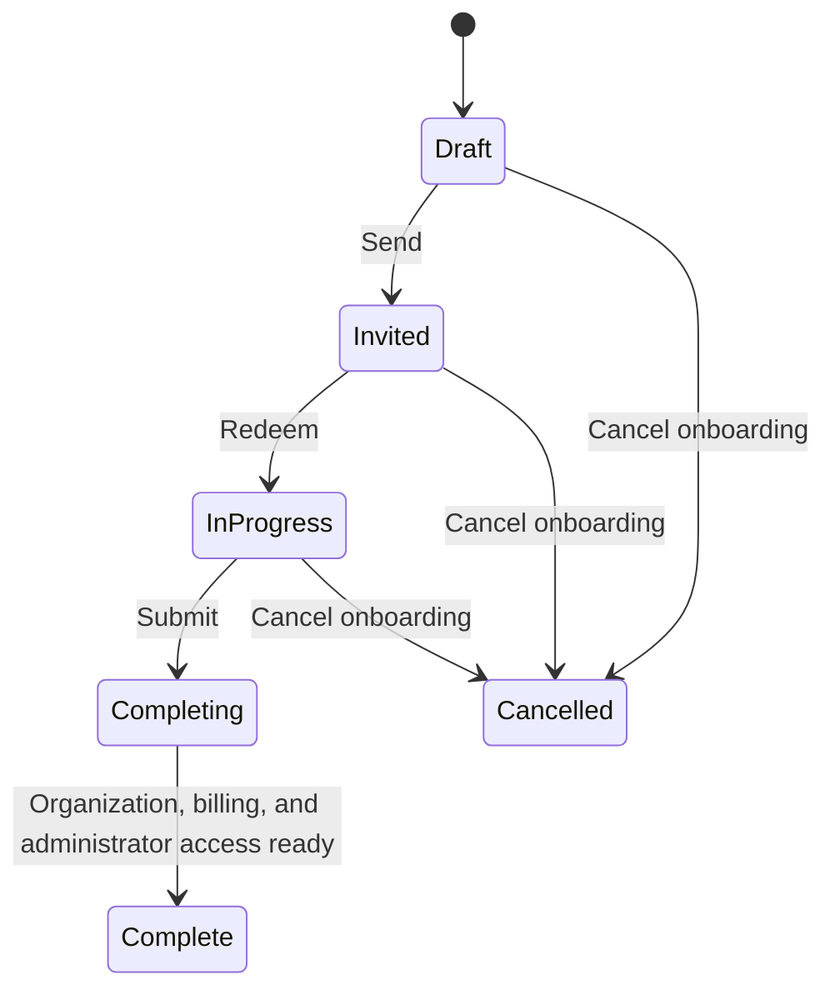

# Native Milo API and onboarding system design

Status: Proposed. This document describes the implementation direction, not functionality already available in CRM. API examples and condition names are proposals until the contracts are implemented.

Product scope: [From sales opportunity to organization onboarding](../enhancements/opportunity-led-onboarding.md). Delivery: [issue #2](https://github.com/milo-os/crm/issues/2).

## Service boundaries

Build CRM as a native Milo service under `crm.miloapis.com/v1alpha1`, using Kubernetes-style resources, reconciliation, validation, and Milo authorization. Start from the conventions in `milo-os/controller-template`. Use one CRM controller deployment and Kubernetes-backed resource storage; a separate CRM database or workflow engine is unnecessary for the first version.

CRM owns Companies, People, Opportunities, onboarding drafts, and invitation lifecycles. Resource Manager owns organizations and membership. Identity and IAM own accounts, authentication, and permissions. Billing owns billing accounts, payment arrangements, terms, and billing readiness. Notifications owns email delivery.



## Resources and relationships

| Resource | Responsibility | Proposed information |
| --- | --- | --- |
| `Company` | Customer relationship | Display name, website, organization links |
| `Person` | Sales contact, including people without accounts | Name, email, Company reference, optional verified Milo User reference |
| `Opportunity` | Potential sale | Company reference, involved People, owner User reference, stage |
| `OrganizationOnboarding` | Durable setup journey for one organization | Company and originating Opportunity references, saved organization and billing details, selected billing arrangement, lifecycle, resulting organization and billing account references |
| `OnboardingInvitation` | One recipient's invitation | Onboarding and Person references, immutable recipient email, expiration, trusted inviter identity, delivery and redemption state |

A Company normally has one organization but can reference multiple. Multiple Opportunities can belong to the same Company. References are separate from ownership: deleting a Company, Opportunity, or onboarding record must not garbage-collect a live organization or billing account.

An onboarding record and an invitation have different lifetimes. Resends and replacements continue the same onboarding. Only a deliberate new onboarding creates another organization. A Person is not a User; linking a contact to an authenticated account requires verified identity, not a staff-entered user identifier.

Place CRM records in the selling organization's administrative context. They must not depend on the prospective customer's organization existing. Final namespace, discovery, and cross-context routing configuration must be checked against Milo tenancy conventions before implementation. References must stay within the authorized selling context, except for explicitly controlled links to resulting customer resources.

## API shape

Expose standard create, get, list, watch, and update operations for CRM resources through Milo. Use `spec` for desired input, `status` for controller-observed results, standard conditions and `observedGeneration`, and resource versions for concurrent updates. Clients cannot write completion state or trusted authorization evidence.

Example onboarding draft:

```yaml
apiVersion: crm.miloapis.com/v1alpha1
kind: OrganizationOnboarding
metadata:
  name: acme-onboarding
spec:
  companyRef:
    name: acme
  opportunityRef:
    name: acme-initial-sale
  organizationDetails:
    displayName: Acme
    contactInfo:
      name: Jane Smith
      email: jane@acme.example
      businessName: Acme Inc.
  billing:
    paymentArrangement: Invoice
```

The billing block is abbreviated: billing contact details and currency must follow Billing's contract. CRM stores a draft, not payment credentials. Card collection uses the existing billing/provider flow.

Example invitation:

```yaml
apiVersion: crm.miloapis.com/v1alpha1
kind: OnboardingInvitation
metadata:
  name: acme-jane
spec:
  onboardingRef:
    name: acme-onboarding
  personRef:
    name: jane-smith
  recipientEmail: jane@acme.example
  expiresAt: "2026-11-15T00:00:00Z"
```

An invitation captures the recipient email at issuance; changing a Person does not redirect an existing invitation. The service records the authenticated inviter and invoice authorization evidence, rather than trusting caller-supplied attribution.

Define explicit operations for send, resend, replace, cancel, redeem, save details, and submit. These are behavioral contracts, not a claim that CRDs automatically provide custom action endpoints. Choose request resources or a Milo-compatible API extension for these operations before implementation. Authentication and token exchange need a server-side handler even when durable state is stored in CRDs.

| Operation | Required behavior |
| --- | --- |
| Send | Validate references and permission, freeze staff-prepared details and billing arrangement, activate the invitation, enqueue email |
| Resend | Send another delivery for the same onboarding and intended recipient; do not create an organization; renew expired credentials explicitly |
| Replace | Invalidate prior invitation and recipient access, preserve organization draft details, issue to the replacement recipient |
| Cancel invitation | Revoke access while retaining saved onboarding for a later replacement |
| Redeem | Require a valid invitation and authenticated, verified matching email; establish access to this onboarding only |
| Save details | Allow only the current recipient to update permitted draft fields using concurrency checks |
| Submit | Validate requirements, freeze submitted details and recipient, and begin idempotent completion |

Repeated action requests need stable request identifiers so retries do not send unintended duplicate emails or create duplicate invitations. A user-requested resend is a distinct delivery action.

## Lifecycle and reconciliation



Invitation delivery, expiration, and revocation have their own conditions. An expired invitation does not erase onboarding progress. Replacing a recipient preserves the draft but clears recipient-specific identity and agreement acceptance. The new recipient must review the details and accept agreements personally.

Keep one authoritative current-invitation reference or generation on the onboarding. Check it on redemption and every recipient request, including requests from existing sessions. Replacement and submission compete through a resource-version-checked transition on the same record: only one wins. Do not replace or cancel while completion is committing; retries resume completion. After completion, administrator changes use the existing membership workflow.

Create the underlying Organization and BillingAccount when required during authenticated onboarding, particularly for payment collection. Resource creation does not mean onboarding is complete. Prior to completion, expose only the access needed for onboarding, not general organization administration.

Use stable identities derived from the onboarding UID for provisioned resources and verify their provenance before reuse. Reconciliation must recover after a restart between organization creation, billing setup, membership creation, and status updates. Show actionable pending/failure conditions without requiring manual approval or creating a second organization.

Completion requires validated organization details, required agreements for the current recipient, billing readiness, organization readiness, and effective first-administrator access. Create the administrator membership for the verified completing User, not the salesperson or CRM service account. Mark Complete only after the permission bindings are usable. Preserve completion as a historical event; later billing suspension belongs to ongoing account lifecycle management.

Notify the Opportunity owner once completion occurs, link the resulting organization to the Company and Opportunity, and leave the Opportunity stage unchanged. Email delivery failure must be retryable without reversing a completed onboarding. Cancellation of abandoned onboarding needs an explicit retention/cleanup policy for partially created resources; do not delete financial resources by cascading CRM ownership.

## Invoice and card billing

Authorized staff select `Card` or `Invoice` before sending. Use Card as the default. The one staff onboarding permission includes this choice for the first version. Customers can correct billing contact details but cannot change the arrangement. The service records who authorized invoicing and when; neither a forged field nor a customer-created BillingAccount may grant invoice eligibility.

CRM passes the chosen arrangement and trusted authorization to Billing through a restricted integration. Once created, the BillingAccount is the source of truth. Freeze the choice in this onboarding flow; subsequent arrangement changes belong to a separately authorized billing workflow. Do not continuously overwrite billing policy from a stale CRM draft.

Propose a billing-owned `ReadyForUse` condition:

| Arrangement | Readiness requirements |
| --- | --- |
| Card | Required billing details are complete, the account is usable, and its default payment method is ready |
| Invoice | Required billing details are complete, the account is usable, and invoicing was authorized by staff; no payment method is required |

Billing defines account usability, including relevant suspension and invoice-health constraints. Resource Manager consumes this condition for the designated onboarding billing account instead of directly requiring `DefaultPaymentMethodReady`. CRM must not set Organization readiness itself or treat any unrelated ready billing account as satisfying the journey.

Keep `DefaultPaymentMethodReady` truthful for invoice accounts: it can remain false when no payment method exists. Existing `InvoicingReady` describes invoice payment health, not permission to use invoice billing, and must not be repurposed as authorization. Billing and provider consumers must honor the arrangement so invoice customers are not routed into card-only charge processing.

Invoice customers use Billing's standard terms. The inspected Billing API currently defaults to net 30 and monthly invoices; the UI should use Billing's effective terms rather than hard-code those defaults. Custom terms and credit limits are outside CRM v1. Staff authorization happens before invitation, so invoice onboarding has no additional manual review.

Introduce the new arrangement with backward-compatible Card semantics for existing accounts. Billing must publish the new readiness condition before Resource Manager relies on it. Unknown or missing readiness remains pending rather than allowing onboarding to complete. Verify existing card onboarding during rollout.

## Access and invitation security

One staff-facing onboarding permission covers preparing, sending, resending, replacing, cancelling, viewing progress, and authorizing invoice billing. CRM record access still follows Milo's administrative-context rules. Use a least-privilege service identity for organization, billing, membership, and notification integration.

Recipients receive a limited projection of their current onboarding, not general CRM access. Omit sales notes, Opportunity details, other People, and internal authorization data. Enforce field-level restrictions server-side, including after an invitation has been redeemed. Record agreement version, authenticated User, and acceptance time separately from reusable organization details.

Use expiring, revocable invitation credentials; store only a verifier in restricted state and keep raw credentials out of readable CRM fields, status, and logs. Email payloads that contain the link also require restricted access. Reuse Milo authentication for account creation and email verification; verify platform eligibility explicitly so a new invited user does not encounter an unrelated manual access approval. Redemption establishes a scoped session, while the current invitation generation remains authoritative for revocation.

## Existing foundations and required changes

These source references describe the locally inspected APIs, not new functionality already implemented:

- [Controller template](https://github.com/milo-os/controller-template): CRD, reconciliation, webhook, deployment, and UI conventions.
- [Organization API](https://github.com/milo-os/milo/blob/main/pkg/apis/resourcemanager/v1alpha1/organization_types.go) and [onboarding controller](https://github.com/milo-os/milo/blob/main/internal/controllers/resourcemanager/organization_onboarding.go): currently require contact details, a billing account, and a ready payment method. Add arrangement-aware billing readiness consumption.
- [Organization bootstrap](https://github.com/milo-os/milo/blob/main/internal/controllers/resourcemanager/organization_bootstrap.go) and [membership API](https://github.com/milo-os/milo/blob/main/pkg/apis/resourcemanager/v1alpha1/organizationmembership_types.go): reuse membership and role reconciliation, with an explicit trusted path assigning the recipient rather than the resource creator. Exact owner/admin role mapping must be verified.
- [BillingAccount API](https://github.com/milo-os/billing/blob/main/api/v1alpha1/billingaccount_types.go): already includes contact details, payment terms, payment-method references, and invoice-health conditions. Add payment arrangement, restricted invoice authorization, and aggregate readiness.
- [Email API](https://github.com/milo-os/milo/blob/main/pkg/apis/notification/v1alpha1/email_types.go): supports literal email recipients and template-based delivery. Create stable Email resources for invitation and completion deliveries.
- [UserInvitation](https://github.com/milo-os/milo/blob/main/pkg/apis/iam/v1alpha1/userinvitation_types.go) targets existing-organization membership; [PlatformInvitation](https://github.com/milo-os/milo/blob/main/pkg/apis/iam/v1alpha1/platforminvitation_types.go) handles platform access. Reuse relevant mechanisms without assuming either already implements this onboarding journey or its revocation semantics.

## Implementation sequence and verification

1. Define CRM schemas, administrative scoping, validation, and staff permission mappings.
2. Add Billing arrangement authorization and readiness; update Resource Manager's onboarding check with backward-compatible card behavior.
3. Implement invitation operations, recipient projection, authentication, revocation, and notification delivery.
4. Reconcile organization/billing setup and final administrator membership, then connect staff and customer interfaces.

Verify card and invoice happy paths, denied customer attempts to select Invoice, invoice setup without a payment method, default terms, and existing card-account behavior. Cover replacement after saved progress and redemption, old-session revocation, expiration, duplicate requests, concurrent replace/submit, controller restarts, email failures, partial provisioning, administrator-role readiness, and tenancy isolation.

Before implementation, settle the action API mechanism, exact namespace/discovery routing, scoped recipient access during billing setup, platform invitation integration, required billing fields, invitation lifetime, and abandoned-resource retention. These are engineering contract decisions; they do not reopen the agreed product behavior.
