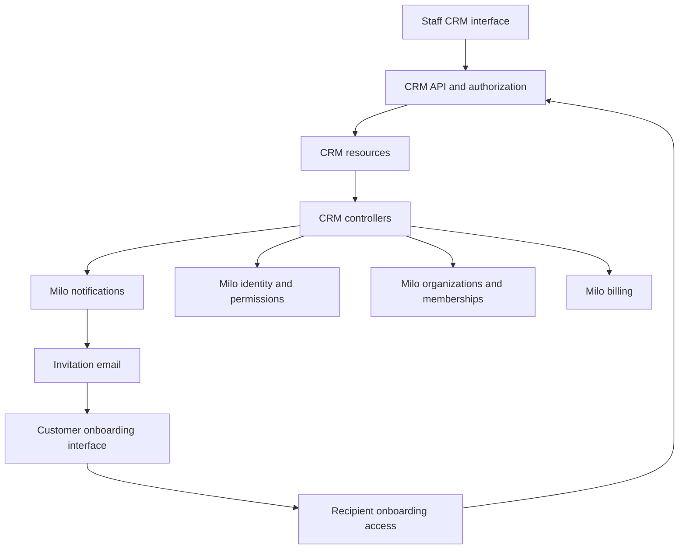
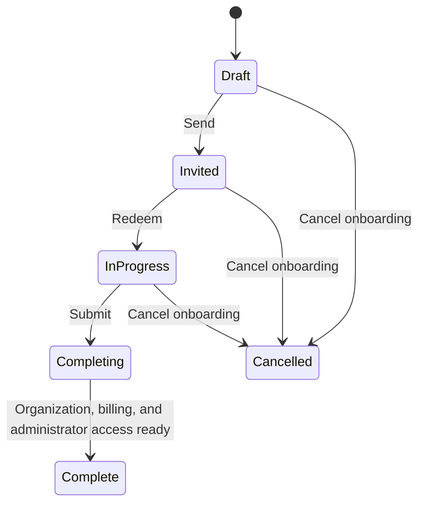

# Native Milo API and onboarding system design

Status: V1 implementation defaults agreed; three external dependencies remain open below. This document describes intended functionality, not an implemented CRM service. CRM API examples illustrate the agreed direction; exact schemas remain implementation work. Existing Milo and Billing APIs are identified separately below.

Product scope: [From sales opportunity to organization onboarding](../enhancements/opportunity-led-onboarding.md). Delivery: [issue #2](https://github.com/milo-os/crm/issues/2).

## Service boundaries

Build CRM as a native Milo service under `crm.miloapis.com/v1alpha1`, using Kubernetes-style resources, reconciliation, validation, and Milo authorization. Start from the conventions in `milo-os/controller-template`. Use one CRM controller deployment and Kubernetes-backed resource storage; a separate CRM database or workflow engine is unnecessary for the first version.

CRM owns Companies, People, Opportunities, onboarding drafts, and invitation lifecycles. Resource Manager owns organizations and membership. Identity and IAM own accounts, authentication, and permissions. Billing owns billing accounts, payment arrangements, terms, and billing readiness. Notifications owns email delivery.



## Resources and relationships

| Resource | Responsibility | Proposed information |
| --- | --- | --- |
| `Company` | Customer relationship | Display name, website, organization links |
| `Person` | Sales contact, including people without accounts | Name, email, Company reference, optional verified Milo User reference |
| `Opportunity` | Potential sale | Company reference, involved People, owner User reference, stage |
| `OrganizationOnboarding` | Durable setup journey for one organization | Company and originating Opportunity references, saved organization and billing details, selected billing arrangement, lifecycle, resulting organization and billing account references |
| `OnboardingInvitation` | One recipient's invitation | Onboarding and Person references, immutable recipient email, expiration, trusted inviter identity, delivery and redemption state |

A Company normally has one organization but can reference multiple. Multiple Opportunities can belong to the same Company. References are separate from ownership: deleting a Company, Opportunity, or onboarding record must not garbage-collect a live organization or billing account.

An onboarding record and an invitation have different lifetimes. Resends and replacements continue the same onboarding. Only a deliberate new onboarding creates another organization. A Person is not a User; linking a contact to an authenticated account requires verified identity, not a staff-entered user identifier.

Place CRM records in the selling organization's administrative context. V1 supports one selling organization, with references scoped to it. Records must not depend on the prospective customer's organization existing. Implement namespace, discovery, and cross-context routing using Milo tenancy conventions. References stay within the authorized selling context, except for explicitly controlled links to resulting customer resources.

## API shape

Expose standard create, get, list, watch, and update operations for CRM resources through Milo. Use `spec` for desired input, `status` for controller-observed results, standard conditions and `observedGeneration`, and resource versions for concurrent updates. Clients cannot write completion state or trusted authorization evidence.

Example onboarding draft:

```yaml
apiVersion: crm.miloapis.com/v1alpha1
kind: OrganizationOnboarding
metadata:
  name: acme-onboarding
spec:
  companyRef:
    name: acme
  opportunityRef:
    name: acme-initial-sale
  organizationDetails:
    displayName: Acme
    contactInfo:
      name: Jane Smith
      email: jane@acme.example
      businessName: Acme Inc.
  billing:
    paymentArrangement: Invoice
```

The billing block is a CRM draft choice, not a proposed field on BillingAccount. Billing contact details and currency follow Billing’s existing contract. For Invoice, CRM creates a BillingArrangement for the account; Card uses the existing payment-method flow. CRM stores no payment credentials.

Example invitation:

```yaml
apiVersion: crm.miloapis.com/v1alpha1
kind: OnboardingInvitation
metadata:
  name: acme-jane
spec:
  onboardingRef:
    name: acme-onboarding
  personRef:
    name: jane-smith
  recipientEmail: jane@acme.example
  expiresAt: "2026-11-15T00:00:00Z"
```

An invitation captures the recipient email at issuance; changing a Person does not redirect an existing invitation. The service records the authenticated inviter and invoice authorization evidence, rather than trusting caller-supplied attribution.

Use a thin Milo-authenticated server-side action API for send, resend, replace, cancel, redeem, save details, and submit. Keep durable state in the five CRDs; do not add a request resource for each action. CRDs do not automatically provide custom action endpoints, so implement handlers with Milo authentication and authorization. Recipients use these handlers rather than accessing CRM resources directly.

| Operation | Required behavior |
| --- | --- |
| Send | Validate references and permission, freeze staff-prepared details and billing arrangement, activate the invitation, enqueue email |
| Resend | Issue a fresh seven-day link for the same onboarding and recipient, invalidate the previous link, and send a new delivery; do not create an organization |
| Replace | Invalidate prior invitation and recipient access, preserve organization draft details, issue to the replacement recipient |
| Cancel invitation | Revoke access while retaining saved onboarding for a later replacement |
| Redeem | Require a valid invitation and authenticated, verified matching email; establish access to this onboarding only |
| Save details | Allow only the current recipient to update permitted draft fields using concurrency checks |
| Submit | Validate requirements, freeze submitted details and recipient, and begin idempotent completion |

Repeated action requests need stable request identifiers so retries do not send unintended duplicate emails or create duplicate invitations. A user-requested resend is a distinct delivery action.

## Lifecycle and reconciliation



Invitation links expire seven days after issuance. Resends and replacements issue fresh seven-day links and invalidate previous credentials. Invitation delivery, expiration, and revocation have their own conditions. Expiration and cancellation revoke scoped onboarding access, including existing sessions; enforce validity on every recipient request. An expired invitation does not erase onboarding progress. Replacing a recipient preserves the draft but clears recipient-specific identity and agreement acceptance. The new recipient must review the details and accept agreements personally.

Keep one authoritative current-invitation reference or generation on the onboarding. Check it on redemption and every recipient request, including requests from existing sessions. Replacement and submission compete through a resource-version-checked transition on the same record: only one wins. Do not replace or cancel while completion is committing; retries resume completion. After completion, administrator changes use the existing membership workflow.

Create the underlying Organization and BillingAccount after the recipient signs in and redeems the invitation, when billing setup requires them. Resource creation does not mean onboarding is complete. Prior to completion, expose only the access needed for onboarding, not general organization administration.

Use stable identities derived from the onboarding UID for provisioned resources and verify their provenance before reuse. Reconciliation must recover after a restart between organization creation, billing setup, membership creation, and status updates. Show actionable pending/failure conditions without requiring manual approval or creating a second organization.

Completion requires validated organization details, required agreements for the current recipient, billing readiness, organization readiness, and effective first-administrator access. Create the administrator membership for the verified completing User, not the salesperson or CRM service account. Show “Finishing setup” while controllers reconcile and mark Complete only after the organization, billing requirements, and administrator permission bindings are ready. Controller delays do not introduce manual review. Preserve completion as a historical event; later billing suspension belongs to ongoing account lifecycle management.

Notify the Opportunity owner once completion occurs, link the resulting organization to the Company and Opportunity, and leave the Opportunity stage unchanged. Email delivery failure must be retryable without reversing a completed onboarding. For v1, retain saved progress and partially created organizations and financial records when onboarding is abandoned or canceled. Do not implement automatic deletion or cascade financial-resource deletion from CRM ownership. Expiration and cancellation revoke onboarding access. Automated retention and cleanup policy is deferred beyond v1.

## Invoice and card billing

Authorized staff select `Card` or `Invoice` before sending. Use Card as the default. The one staff onboarding permission includes this choice for the first version. Customers can correct billing contact details but cannot change the arrangement. The service records who authorized invoicing and when; neither a forged field nor a customer-created BillingAccount may grant invoice eligibility.

CRM reconciles the customer's BillingAccount and, for Invoice, an existing `billing.miloapis.com/v1alpha1` `BillingArrangement` with `spec.type: Invoice`. Leave `applicationRef` unset: Billing explicitly supports this sales-led grant without a customer application or another review. Use a stable arrangement identity tied to onboarding so retries do not create overlapping arrangements.

The arrangement is the billing policy source of truth; Billing publishes its customer-visible terms on `BillingAccount.status.paymentArrangement`. Freeze the selection in the onboarding flow and do not overwrite later billing changes from a stale CRM draft. Card onboarding does not create an Invoice arrangement.

Consume the existing billing-owned `PaymentReady` condition:

| Customer choice | Existing Billing behavior | CRM responsibility |
| --- | --- | --- |
| Card | An active default payment method can make `PaymentReady=True` | Complete billing details and the existing payment-method setup flow |
| Invoice | An active Invoice BillingArrangement can make `PaymentReady=True` without a card | Create the authorized arrangement with standard terms and wait for reconciliation |

Milo's current organization onboarding controller already checks `PaymentReady`, with a `DefaultPaymentMethodReady` fallback for older Billing deployments. No new `ReadyForUse` condition or invoice-specific Resource Manager readiness implementation is needed. CRM checks the designated onboarding billing account as well as organization readiness: the existing organization controller accepts any qualifying billing account in the organization.

`PaymentReady` means the account has a way to pay; it is not an aggregate of every account, contact, suspension, or invoice-health requirement. Keep validation of required details and account/access eligibility explicit. `InvoicingReady` continues to describe invoice payment health, and `DefaultPaymentMethodReady` can remain false for invoice customers. A scheduled or pending arrangement alone does not qualify; wait for an active arrangement. For the Invoice choice, verify that the expected arrangement is active rather than treating an unrelated card as proof it was granted.

BillingAccount standard terms are net 30, monthly, on the first; use Billing's published effective terms in the UI. The existing BillingArrangement also requires an internal reason and an invoice credit limit. Use a centrally configured, finance-approved credit-limit default for each supported account currency, and generate the internal reason from the staff-authorized onboarding reference. Capture the authenticated staff actor in the audit trail. Finance must establish the default before invoice invitations are enabled; do not invent an amount or use zero as an unlimited sentinel. Editing custom terms or credit limits remains outside CRM v1.

Verify the deployed Billing and Milo versions provide these existing contracts. The source describes the compatibility fallback as removable once environments use Billing v0.3.10 or later; deployment state and provider invoice collection behavior still need integration verification. Keep missing or unknown required readiness pending. Staff authorization occurs before invitation, with no customer application or manual review added to onboarding.

## Access and invitation security

One staff-facing onboarding permission covers preparing, sending, resending, replacing, cancelling, viewing progress, and authorizing invoice billing. CRM record access still follows Milo's administrative-context rules. Use a least-privilege service identity for organization, billing, membership, and notification integration.

Recipients receive a limited projection of their current onboarding, not general CRM access. Omit sales notes, Opportunity details, other People, and internal authorization data. Enforce field-level restrictions server-side, including after an invitation has been redeemed. Record agreement version, authenticated User, and acceptance time separately from reusable organization details.

Use expiring, revocable invitation credentials; store only a verifier in restricted state and keep raw credentials out of readable CRM fields, status, and logs. Email payloads that contain the link also require restricted access. Reuse Milo authentication for account creation and require a verified matching email explicitly at redemption. The platform’s email-verification enforcement is feature-gated and defaults off, so authentication alone is insufficient evidence. Redemption establishes a scoped session, while the current invitation generation remains authoritative for revocation.

## Platform access and first administrator

Use the existing `PlatformAccess` resource as the authority for platform eligibility. It has Pending, Approved, Rejected, and Suspended states; the User controller derives access from it. The PlatformInvitation controller handles invitation email delivery and is not proof of approval. Do not build new work on the legacy PlatformAccessApproval resources.

The agreed integration behavior is: after verified redemption, ensure a new or Pending user's PlatformAccess is Approved through a narrowly authorized operation backed by the staff invitation. Preserve existing Approved access. Do not overwrite Rejected or Suspended access; surface the existing account restriction instead. Platform-access coordination remains an open dependency: establish the authorized transition and writer coordination with the platform's current access-policy controller so reconciliation cannot fight over the state. This uses the staff authorization already given, not a new manual review. Canceling CRM onboarding revokes its scoped access, not unrelated platform or organization access.

Reuse OrganizationMembership and its role reconciliation for the completing user. Milo's configured default owner role is `resourcemanager.miloapis.com-organizationowner`; confirm the deployed role and permissions and use the configured owner role for the first administrator rather than inventing a CRM role.

Organization admission currently bootstraps creator ownership, with an exception for `system:masters`. CRM should not receive that broad privilege or impersonate the customer just to create an organization. The remaining platform integration is a narrowly permissioned service-creation path that skips creator membership and creator annotation, allowing CRM to grant the final recipient membership explicitly on completion. Apply it consistently to named and generated-name creation paths. Before implementation, verify whether the target deployment already offers such a path; otherwise this is a small Resource Manager change, not a replacement membership system.

## Existing capabilities and source baseline

The capability audit compared local checkouts with GitHub main. The local billing and onboarding code was behind. Verified source revisions:

- Milo: `303297eca044e0deb080a6482662c7cef1601f18`.
- Billing: `433849909b4dc7dbf17163232415c59a2f1fe602`.
- Zitadel provider: `177761243a6ab1fa96cbdbfaaaa5c6c429c101cd`.

This establishes source capabilities, not deployed versions or enabled feature gates.

| Existing capability | Reuse in CRM | Remaining integration |
| --- | --- | --- |
| [BillingArrangement](https://github.com/milo-os/billing/blob/433849909b4dc7dbf17163232415c59a2f1fe602/api/v1alpha1/billingarrangement_types.go) | Staff-granted invoice terms, sales-led grants without applications | Authorized creation, required reason and configured credit limit, stable resource identity |
| [BillingAccount](https://github.com/milo-os/billing/blob/433849909b4dc7dbf17163232415c59a2f1fe602/api/v1alpha1/billingaccount_types.go) | Contact details, standard terms, published arrangement, PaymentReady | Use the existing contract and check the journey's account |
| [Organization onboarding](https://github.com/milo-os/milo/blob/303297eca044e0deb080a6482662c7cef1601f18/internal/controllers/resourcemanager/organization_onboarding.go) | PaymentReady consumption and older-controller fallback | Observe existing readiness; no new billing condition |
| [Organization admission](https://github.com/milo-os/milo/blob/303297eca044e0deb080a6482662c7cef1601f18/internal/webhooks/resourcemanager/v1alpha1/organization_webhook.go) | Namespace setup and organization lifecycle | Narrow service-created organization path without granting the creator ownership |
| [OrganizationMembership](https://github.com/milo-os/milo/blob/303297eca044e0deb080a6482662c7cef1601f18/pkg/apis/resourcemanager/v1alpha1/organizationmembership_types.go) | Membership and role reconciliation | Assign completing recipient and wait for effective permissions |
| [PlatformAccess](https://github.com/milo-os/milo/blob/303297eca044e0deb080a6482662c7cef1601f18/pkg/apis/iam/v1alpha1/platformaccess_types.go) | Existing account eligibility states | Staff-backed approval of eligible new/Pending users; preserve restrictions |
| [PlatformInvitation controller](https://github.com/milo-os/milo/blob/303297eca044e0deb080a6482662c7cef1601f18/internal/controllers/iam/platforminvitation_controller.go) | Existing platform invitation delivery pattern | Do not mistake delivery for approval or send a redundant platform email |
| [UserInvitation controller](https://github.com/milo-os/milo/blob/303297eca044e0deb080a6482662c7cef1601f18/internal/controllers/iam/userinvitation_controller.go) | Recipient matching, expiration, email and membership patterns | CRM still owns saved progress and replacement; accepted user invitations are deleted |
| [Email API](https://github.com/milo-os/milo/blob/303297eca044e0deb080a6482662c7cef1601f18/pkg/apis/notification/v1alpha1/email_types.go) | Template delivery to literal email addresses | Stable invitation/completion delivery resources and retries |
| [Email verification feature gate](https://github.com/milo-os/milo/blob/303297eca044e0deb080a6482662c7cef1601f18/pkg/features/features.go) | Existing verification machinery | Require verified email at redemption independently of global enforcement |

Use the [controller template](https://github.com/milo-os/controller-template) for service conventions. No new authentication provider, payment-arrangement model, billing-readiness condition, notification transport, or membership engine is in scope.

## Remaining implementation work

1. Define the five CRM resources, administrative scoping, reference validation, and staff permission mappings.
2. Implement the action API, saved drafts, recipient projection, current-invitation checks, replacement, revocation, and resumable progress.
3. Integrate verified authentication and PlatformAccess; establish the narrow organization-creation path and configured first-owner role.
4. Reconcile existing Organization, BillingAccount, BillingArrangement, OrganizationMembership, and Email resources with stable identities and retry-safe transitions.
5. Build the staff and customer interfaces, completion visibility, and Opportunity-owner notification without changing Opportunity stage.

Validate card and invoice journeys against the existing platform APIs: invoice onboarding without a payment method or application, denied customer arrangement changes, active versus scheduled arrangements, standard terms and required credit-limit configuration, and missing readiness. Cover new/Pending/Approved/restricted users, verified-email enforcement when the global gate is off, replacement after redemption, old-session revocation, expiration, duplicate requests, concurrent replace/submit, controller restarts, email failures, partial provisioning, first-owner permissions, and tenancy isolation.

## Open dependencies

The v1 defaults above are settled. Three dependencies remain open; their resolution must preserve the agreed customer journey without adding another manual approval.

| Dependency | Agreed direction | Resolution needed | Blocks |
| --- | --- | --- | --- |
| Finance-approved credit limit | Configure a default per supported currency outside the customer form; no custom-limit editing in CRM v1 | Finance supplies the approved values and configuration ownership | Enabling invoice invitations for a currency without an approved default |
| Organization-creation permission path | Use a narrow service permission that skips creator ownership; never grant CRM system:masters | Confirm an existing supported path or implement the Resource Manager permission check, including named and generated-name creation | Provisioning customer organizations through CRM |
| Platform-access coordination | Staff authorization approves eligible new/Pending users; preserve Approved, Rejected, and Suspended states as described above | Agree the authorized transition and state-writer coordination with the platform access-policy controller | Automatic platform approval for eligible invited users |

CRM schemas, ordinary record management, basic screens, and invitation state handling can begin while these dependencies are resolved. Integration code must not substitute permissive fallbacks for unresolved dependencies.

## Deployment verification

Before enabling the end-to-end flow, verify the target environment's BillingArrangement, PaymentReady, and organization-readiness support; the configured organization-owner role and its effective permissions; and the deployed provider's invoice collection behavior. Exercise card and invoice onboarding against that environment. These are release checks, not additional open product or architecture choices.
