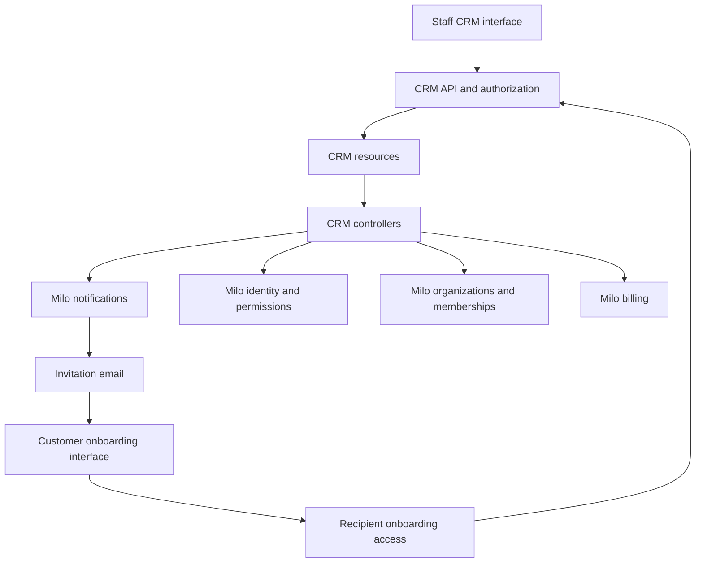
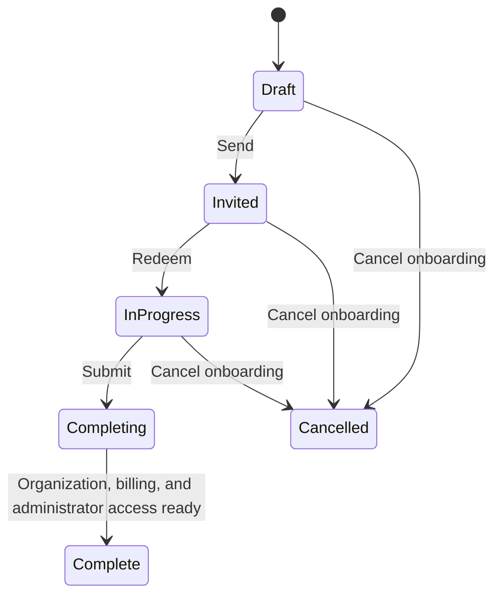

# Native Milo API and onboarding system design

Status: V1 implementation defaults agreed; two external dependencies remain open below. This document describes intended functionality, not an implemented CRM service. CRM API examples illustrate the agreed direction; exact schemas remain implementation work. Existing Milo and Billing APIs are identified separately below.

Product scope: [From sales opportunity to organization onboarding](../enhancements/opportunity-led-onboarding.md). Delivery: [issue #2](https://github.com/milo-os/crm/issues/2).

## Service boundaries

Build CRM as a native Milo service under `crm.miloapis.com/v1alpha1`, using Kubernetes-style resources, reconciliation, validation, and Milo authorization. Start from the conventions in `milo-os/controller-template`. Use one CRM controller deployment and Kubernetes-backed resource storage; a separate CRM database or workflow engine is unnecessary for the first version.

CRM owns Companies, People, Opportunities, onboarding drafts, and invitation lifecycles. Resource Manager owns organizations and membership. Identity and IAM own accounts, authentication, and permissions. Billing owns billing accounts, payment arrangements, terms, and billing readiness. Notifications owns email delivery.



## Resources and relationships

| Resource | Responsibility | Proposed information |
| --- | --- | --- |
| `Company` | Customer relationship | Display name, website, organization links |
| `Person` | Sales contact, including people without accounts | Name, email, Company reference, optional verified Milo User reference |
| `Opportunity` | Potential sale | Short description, Company reference, involved People, owner User reference, stage |
| `OrganizationOnboarding` | Durable setup journey for one organization | Company and originating Opportunity references, saved organization and billing details, selected billing currency and arrangement, lifecycle, resulting organization and billing account references |
| `OnboardingInvitation` | One recipient's invitation | Onboarding and Person references, immutable recipient email, trusted inviter identity; in status, phase, expiration, delivery and redemption state |
| `OnboardingSubmission` | What one recipient enters | Onboarding and invitation references, the organization and billing details the customer completes, whether they submitted; created by CRM for each invitation, owned by the customer, read-only to staff |

Every reference must point to a record that exists, whether it names another CRM record, a Milo Organization or User, or a BillingAccount, and in spec or in the status CRM writes. Cross references must agree: People named on an Opportunity or invitation work for its Company, an onboarding's Opportunity is with its Company, its current invitation is for that onboarding, its organization is one its Company links, its billing account is in its organization's namespace, and the User who redeems an invitation has verified the invitation's email. Admission webhooks check this when a reference is set or changed. A Person's Company can't change: someone who moves to another Company is a new Person there, so every record naming them still points at someone from its Company. Likewise an Opportunity's Company can't change: a sale to another Company is a new Opportunity, so an onboarding's Opportunity stays with its Company. Links CRM records in status to what an invitation or onboarding produced (the inviter, the redeeming User, a Person's User, the created Organization and BillingAccount) can't be changed or removed once set. A Company normally has one organization but can reference multiple. Multiple Opportunities can belong to the same Company. CRM's own records form one ownership tree, so deleting a Company deletes everything about it: the Company owns its People, Opportunities, and onboardings, and each onboarding owns its invitations. Each record has one owner, because Milo's garbage collector only deletes a record once all its owners are gone; deleting a Person deletes their invitations through CRM's controller instead. References to records other services keep are never ownership: deleting a Company, Opportunity, or onboarding record must not garbage-collect a live organization or billing account.

An onboarding record and an invitation have different lifetimes. Resends and replacements continue the same onboarding. Only a deliberate new onboarding creates another organization. A Person is not a User; linking a contact to an authenticated account requires verified identity, not a staff-entered user identifier.

CRM records live at the platform level, outside any organization, and only Milo staff manage them, from the staff portal. Records must not depend on the prospective customer's organization existing: staff can add a Company before it has an organization on the platform. The only links from CRM to customer resources are the explicitly controlled links to resulting resources, such as the customer's Organization and BillingAccount.

Notes and follow-ups on CRM records use Milo's `ClusterNote` (`notes.miloapis.com`), the platform primitive for notes on cluster-scoped resources, with the CRM record as the note's subject. Its next action, due time, and follow-up flag track what happens next, and Milo deletes a record's notes with it. CRM resources have no notes fields of their own; an Opportunity's description is only a short summary of the sale.

### Opportunity stages

Staff move an Opportunity through these stages by hand. A new Opportunity starts at Prospecting. Onboarding can start at any stage, and completing it never changes the stage.

| Stage | Meaning |
| --- | --- |
| `Prospecting` | A potential sale sales has identified but not yet qualified |
| `Qualification` | Sales is confirming the fit: need, budget, and decision makers |
| `Proposal` | An offer has been sent to the customer |
| `Negotiation` | Terms are being agreed |
| `ClosedWon` | The customer agreed to the sale |
| `ClosedLost` | The sale will not happen |

### Resource scoping

Every CRM resource is cluster-scoped, like Billing's staff-managed resources such as `Offer` and `ServicePricing`. No organization owns CRM records or can see them. References between CRM resources are plain names. Staff access comes from CRM roles granted to Milo staff at the platform level; the IAM protected resources have no parent organization, so organization roles never reach CRM records.

## API shape

Expose standard create, get, list, watch, and update operations for CRM resources through Milo. Use `spec` for desired input, `status` for controller-observed results, standard conditions and `observedGeneration`, and resource versions for concurrent updates. Clients cannot write completion state or trusted authorization evidence.

Example onboarding draft:

```yaml
apiVersion: crm.miloapis.com/v1alpha1
kind: OrganizationOnboarding
metadata:
  name: acme-onboarding
spec:
  companyRef:
    name: acme
  opportunityRef:
    name: acme-initial-sale
  organizationDetails:
    displayName: Acme
    contactInfo:
      name: Jane Smith
      email: jane@acme.example
      businessName: Acme Inc.
  billing:
    currency: USD
    paymentArrangement: Invoice
```

Status holds the onboarding's progress, written only by CRM: its phase, current invitation, the invoice authorization (who chose Invoice and when), the resulting organization and billing account, the completion time, and conditions. Staff roles can read status but not change it, so clients can't set completion state or forge invoice authorization. The Company and Opportunity can't be changed after creation. Billing only bills in USD today, so USD is the only accepted currency until Billing supports more.

The billing block is a CRM draft choice, not a proposed field on BillingAccount. Staff choose the billing account currency when preparing the draft; CRM sets it on the BillingAccount using Billing’s existing currency field and supported values. Billing contact details follow Billing’s existing contract. For Invoice, CRM creates a BillingArrangement for the account; Card uses the existing payment-method flow. CRM stores no payment credentials.

Example invitation:

```yaml
apiVersion: crm.miloapis.com/v1alpha1
kind: OnboardingInvitation
metadata:
  name: acme-jane
spec:
  onboardingRef:
    name: acme-onboarding
  personRef:
    name: jane-smith
  recipientEmail: jane@acme.example
```

An invitation captures the recipient email at issuance, which must be the Person's email then; changing a Person does not redirect an existing invitation. The service records the authenticated inviter and invoice authorization evidence, rather than trusting caller-supplied attribution.

Staff send, resend, and replace by creating an invitation; the newest invitation of an onboarding is its current one. Staff can revoke an invitation but not change anything else on it. The onboarding, Person, and recipient email can't be changed after creation. The inviter is recorded in its spec from the authenticated request when staff create it. Status, written only by CRM, records everything CRM does with the invitation: its phase (Pending, Sent, Redeemed, Expired, or Revoked), when it was sent and expires, and the User who redeemed it, whose verified email matched. While the invitation is current, only that User can work on the onboarding, and on completion they become the first administrator. Revocation and expiry are conditions. The invitation never holds the link or anything that could be used as one.

Onboarding actions are writes to the CRM resources themselves, with no separate action API: staff send, resend, and replace by creating an invitation, and cancel with a field; the customer saves details and submits in their own `OnboardingSubmission`, a record CRM creates for each invitation and the customer reaches through a Milo PolicyBinding on that one record. Staff and the customer write different records, so IAM decides who changes what; a defaulting webhook records who acted; controllers send email, grant and revoke access, and provision. [Onboarding actions and customer access](onboarding-actions.md) describes the actions, authorization, redemption, and retries in full.

Repeated action requests need stable request identifiers so retries do not send unintended duplicate emails or create duplicate invitations. A user-requested resend is a distinct delivery action.

## Lifecycle and reconciliation



Invitation links expire seven days after issuance. Resends and replacements issue a new invitation with a fresh seven-day window and revoke the previous one. Invitation delivery, expiration, and revocation have their own conditions. Expiration and cancellation (of an invitation or of the whole onboarding) revoke the recipient's access to the onboarding by removing their binding; the admission webhook also checks the current invitation on every recipient write. An expired invitation does not erase onboarding progress. Replacing a recipient preserves the draft but clears recipient-specific identity and agreement acceptance. The new recipient must review the details and accept agreements personally.

Keep one authoritative current invitation on the onboarding, `status.currentInvitationRef`. Check it on redemption and on submission: CRM only redeems the current invitation and only accepts the submission of the current invitation, so a replaced recipient's writes reach nothing CRM reads. Do not replace or cancel while completion is committing; a cancelled onboarding is terminal, so staff start a new onboarding if the deal resumes; retries resume completion. After completion, administrator changes use the existing membership workflow.

Create the underlying Organization and BillingAccount after the recipient signs in and redeems the invitation, when billing setup requires them. Resource creation does not mean onboarding is complete. Prior to completion, expose only the access needed for onboarding, not general organization administration.

Use stable identities derived from the onboarding UID for provisioned resources and verify their provenance before reuse. Reconciliation must recover after a restart between organization creation, billing setup, membership creation, and status updates. Show actionable pending/failure conditions without requiring manual approval or creating a second organization.

Completion requires validated organization details, required agreements for the current recipient, billing readiness, organization readiness, and effective first-administrator access. Create the administrator membership for the verified completing User, not the salesperson or CRM service account. Show “Finishing setup” while controllers reconcile and mark Complete only after the organization, billing requirements, and administrator permission bindings are ready. Controller delays do not introduce manual review. Preserve completion as a historical event; later billing suspension belongs to ongoing account lifecycle management.

Notify the Opportunity owner once completion occurs, link the resulting organization to the Company and Opportunity, and leave the Opportunity stage unchanged. Email delivery failure must be retryable without reversing a completed onboarding. For v1, retain saved progress and partially created organizations and financial records when onboarding is abandoned or canceled. Do not implement automatic deletion or cascade financial-resource deletion from CRM ownership. Expiration and cancellation revoke onboarding access. Automated retention and cleanup policy is deferred beyond v1.

### Provisioned resources

CRM's controllers create resources in other services: the Organization, the BillingAccount, the Invoice BillingArrangement, and the first administrator's OrganizationMembership. They follow the fan-out pattern in service-catalog (`billing_fanout.go` and the provisioning controller), with one deliberate difference: CRM never owns what it creates.

- **Provenance labels.** Every provisioned resource carries `app.kubernetes.io/managed-by: crm.miloapis.com`, `crm.miloapis.com/organization-onboarding: <name>`, and `crm.miloapis.com/organization-onboarding-uid: <uid>`. The UID label is the authority: a new onboarding can reuse a name, never a UID.
- **No owner references.** Service-catalog sets a controller owner reference so deleting its record garbage-collects what it made. CRM must not: deleting an onboarding must never delete a live organization or billing account. Labels record where a resource came from; nothing ties its lifetime to the onboarding.
- **Stable names.** Names derive from the onboarding UID, so a retry or restart finds the resource it already created instead of creating a second one.
- **Check before reuse.** Before writing to a name that already exists, check that it carries this onboarding's UID label. If it doesn't, leave it untouched and report a condition with reason `ObjectExists`, rather than taking it over.
- **Server-side apply.** Write with server-side apply under a named field manager, `crm-operator`, with one manager per controller so they don't contend over fields. Use the typed apply configurations Billing and Milo publish, such as `go.miloapis.com/billing/applyconfiguration`.
- **Stop writing after completion.** Apply the onboarding's details until it completes, then stop. After completion the customer owns their organization and billing settings, and a reconcile must not revert their changes from the onboarding's draft. CRM only reads readiness from then on.
- **Never delete.** CRM doesn't prune or clean up what it provisioned; abandoned or cancelled onboardings keep their partial resources in v1.
- **Report per resource.** Conditions on the onboarding name each resource's state, such as `OrganizationReady` and `BillingAccountReady`, with reasons such as `ObjectExists` or `ApplyFailed`.

## Invoice and card billing

Authorized staff select `Card` or `Invoice` before sending. Use Card as the default. The one staff onboarding permission includes this choice for the first version. Once the onboarding is sent, nobody can change the currency or arrangement, and the customer corrects the billing contact details in their submission. The service records who authorized invoicing and when; neither a forged field nor a customer-created BillingAccount may grant invoice eligibility.

CRM reconciles the customer's BillingAccount and, for Invoice, an existing `billing.miloapis.com/v1alpha1` `BillingArrangement` with `spec.type: Invoice`. Leave `applicationRef` unset: Billing explicitly supports this sales-led grant without a customer application or another review. Use a stable arrangement identity tied to onboarding so retries do not create overlapping arrangements.

The arrangement is the billing policy source of truth; Billing publishes its customer-visible terms on `BillingAccount.status.paymentArrangement`. Freeze the selection in the onboarding flow and do not overwrite later billing changes from a stale CRM draft. Card onboarding does not create an Invoice arrangement.

Consume the existing billing-owned `PaymentReady` condition:

| Customer choice | Existing Billing behavior | CRM responsibility |
| --- | --- | --- |
| Card | An active default payment method can make `PaymentReady=True` | Complete billing details and the existing payment-method setup flow |
| Invoice | An active Invoice BillingArrangement can make `PaymentReady=True` without a card | Create the authorized arrangement with standard terms and wait for reconciliation |

Milo's current organization onboarding controller already checks `PaymentReady`, with a `DefaultPaymentMethodReady` fallback for older Billing deployments. No new `ReadyForUse` condition or invoice-specific Resource Manager readiness implementation is needed. CRM checks the designated onboarding billing account as well as organization readiness: the existing organization controller accepts any qualifying billing account in the organization.

`PaymentReady` means the account has a way to pay; it is not an aggregate of every account, contact, suspension, or invoice-health requirement. Keep validation of required details and account/access eligibility explicit. `InvoicingReady` continues to describe invoice payment health, and `DefaultPaymentMethodReady` can remain false for invoice customers. A scheduled or pending arrangement alone does not qualify; wait for an active arrangement. For the Invoice choice, verify that the expected arrangement is active rather than treating an unrelated card as proof it was granted.

BillingAccount standard terms are net 30, monthly, on the first; use Billing's published effective terms in the UI. The existing BillingArrangement also requires an internal reason; generate it from the staff-authorized onboarding reference. Capture the authenticated staff actor in the audit trail. Billing is removing the arrangement credit limit, so CRM does not set or configure one and invoice onboarding does not depend on it. Editing custom terms remains outside CRM v1.

Verify the deployed Billing and Milo versions provide these existing contracts. The source describes the compatibility fallback as removable once environments use Billing v0.3.10 or later; deployment state and provider invoice collection behavior still need integration verification. Keep missing or unknown required readiness pending. Staff authorization occurs before invitation, with no customer application or manual review added to onboarding.

## Access and invitation security

One staff-facing onboarding permission covers preparing, sending, resending, replacing, cancelling, viewing progress, and authorizing invoice billing. Only Milo staff can access CRM records. Use a least-privilege service identity for organization, billing, membership, and notification integration.

Recipients reach only their own `OnboardingSubmission`, through a PolicyBinding on that one record, never general CRM access: not the onboarding, sales notes, Opportunity details, or other People. The submission holds only the fields the customer completes, so it is the allowlist of what they can see and change. Record agreement version, authenticated User, and acceptance time separately from reusable organization details.

Invitation links carry no secret: they only name the onboarding. Access comes from a verified email that matches the invitation's recipient, the model Milo's own UserInvitation uses, so there is no credential to store, leak, or expire. Invitations still expire after seven days unless redeemed, and revocation removes the recipient's binding. Reuse Milo authentication for account creation and require a verified matching email explicitly at redemption. The platform's email-verification enforcement is feature-gated and defaults off, so authentication alone is insufficient evidence. See [Onboarding actions and customer access](onboarding-actions.md).

## Platform access and first administrator

Use the existing `PlatformAccess` resource as the authority for platform eligibility. It has Pending, Approved, Rejected, and Suspended states; the User controller derives access from it. The PlatformInvitation controller handles invitation email delivery and is not proof of approval. Do not build new work on the legacy PlatformAccessApproval resources.

The agreed integration behavior is: after verified redemption, ensure the user's PlatformAccess is Approved through a narrowly authorized operation backed by the staff invitation. Preserve existing Approved access. The staff invitation overrides an existing Pending, Rejected, or Suspended state: approve the user, add them to the organization on completion, and send the usual email, without blocking invitation creation or surfacing the earlier restriction to the customer. Record the overridden prior state and the authorizing staff invitation in the audit trail. Platform-access coordination remains an open dependency: establish the authorized transition and writer coordination with the platform's current access-policy controller so reconciliation cannot fight over the state. This uses the staff authorization already given, not a new manual review. Canceling CRM onboarding revokes its scoped access, not unrelated platform or organization access.

Reuse OrganizationMembership and its role reconciliation for the completing user. Milo's configured default owner role is `resourcemanager.miloapis.com-organizationowner`; confirm the deployed role and permissions and use the configured owner role for the first administrator rather than inventing a CRM role.

Organization admission currently bootstraps creator ownership, with an exception for `system:masters`. CRM should not receive that broad privilege or impersonate the customer just to create an organization. The remaining platform integration is a narrowly permissioned service-creation path that skips creator membership and creator annotation, allowing CRM to grant the final recipient membership explicitly on completion. Apply it consistently to named and generated-name creation paths. Before implementation, verify whether the target deployment already offers such a path; otherwise this is a small Resource Manager change, not a replacement membership system.

## Existing capabilities and source baseline

The capability audit compared local checkouts with GitHub main. The local billing and onboarding code was behind. Verified source revisions:

- Milo: `303297eca044e0deb080a6482662c7cef1601f18`.
- Billing: `433849909b4dc7dbf17163232415c59a2f1fe602`.
- Zitadel provider: `177761243a6ab1fa96cbdbfaaaa5c6c429c101cd`.

This establishes source capabilities, not deployed versions or enabled feature gates.

| Existing capability | Reuse in CRM | Remaining integration |
| --- | --- | --- |
| [BillingArrangement](https://github.com/milo-os/billing/blob/433849909b4dc7dbf17163232415c59a2f1fe602/api/v1alpha1/billingarrangement_types.go) | Staff-granted invoice terms, sales-led grants without applications | Authorized creation, required reason, stable resource identity |
| [BillingAccount](https://github.com/milo-os/billing/blob/433849909b4dc7dbf17163232415c59a2f1fe602/api/v1alpha1/billingaccount_types.go) | Contact details, currency, standard terms, published arrangement, PaymentReady | Set the staff-chosen currency, use the existing contract, and check the journey's account |
| [Organization onboarding](https://github.com/milo-os/milo/blob/303297eca044e0deb080a6482662c7cef1601f18/internal/controllers/resourcemanager/organization_onboarding.go) | PaymentReady consumption and older-controller fallback | Observe existing readiness; no new billing condition |
| [Organization admission](https://github.com/milo-os/milo/blob/303297eca044e0deb080a6482662c7cef1601f18/internal/webhooks/resourcemanager/v1alpha1/organization_webhook.go) | Namespace setup and organization lifecycle | Narrow service-created organization path without granting the creator ownership |
| [OrganizationMembership](https://github.com/milo-os/milo/blob/303297eca044e0deb080a6482662c7cef1601f18/pkg/apis/resourcemanager/v1alpha1/organizationmembership_types.go) | Membership and role reconciliation | Assign completing recipient and wait for effective permissions |
| [PlatformAccess](https://github.com/milo-os/milo/blob/303297eca044e0deb080a6482662c7cef1601f18/pkg/apis/iam/v1alpha1/platformaccess_types.go) | Existing account eligibility states | Staff-backed approval of invited users, including overriding Rejected or Suspended states |
| [PlatformInvitation controller](https://github.com/milo-os/milo/blob/303297eca044e0deb080a6482662c7cef1601f18/internal/controllers/iam/platforminvitation_controller.go) | Existing platform invitation delivery pattern | Do not mistake delivery for approval or send a redundant platform email |
| [UserInvitation controller](https://github.com/milo-os/milo/blob/303297eca044e0deb080a6482662c7cef1601f18/internal/controllers/iam/userinvitation_controller.go) | Recipient matching, expiration, email and membership patterns | CRM still owns saved progress and replacement; accepted user invitations are deleted |
| [Email API](https://github.com/milo-os/milo/blob/303297eca044e0deb080a6482662c7cef1601f18/pkg/apis/notification/v1alpha1/email_types.go) | Template delivery to literal email addresses | Stable invitation/completion delivery resources and retries |
| [Email verification feature gate](https://github.com/milo-os/milo/blob/303297eca044e0deb080a6482662c7cef1601f18/pkg/features/features.go) | Existing verification machinery | Require verified email at redemption independently of global enforcement |

Use the [controller template](https://github.com/milo-os/controller-template) for service conventions. No new authentication provider, payment-arrangement model, billing-readiness condition, notification transport, or membership engine is in scope.

## Remaining implementation work

1. Define the six CRM resources, administrative scoping, reference validation, and staff permission mappings.
2. Implement the onboarding actions (onboarding-actions.md): saved drafts, recipient access, current-invitation checks, replacement, revocation, onboarding cancellation, and resumable progress.
3. Integrate verified authentication and PlatformAccess; establish the narrow organization-creation path and configured first-owner role.
4. Reconcile existing Organization, BillingAccount, BillingArrangement, OrganizationMembership, and Email resources with stable identities and retry-safe transitions.
5. Build the staff and customer interfaces, completion visibility, and Opportunity-owner notification without changing Opportunity stage.

Validate card and invoice journeys against the existing platform APIs: invoice onboarding without a payment method or application, denied customer arrangement changes, active versus scheduled arrangements, standard terms, staff-chosen currency, and missing readiness. Cover new/Pending/Approved users and staff override of Rejected/Suspended users, verified-email enforcement when the global gate is off, replacement after redemption, old-session revocation, expiration, cancelling a whole onboarding, duplicate requests, concurrent replace/submit, controller restarts, email failures, partial provisioning, first-owner permissions, and tenancy isolation.

## Open dependencies

The v1 defaults above are settled. Two dependencies remain open; their resolution must preserve the agreed customer journey without adding another manual approval.

| Dependency | Agreed direction | Resolution needed | Blocks |
| --- | --- | --- | --- |
| Organization-creation permission path | Use a narrow service permission that skips creator ownership; never grant CRM system:masters | Confirm an existing supported path or implement the Resource Manager permission check, including named and generated-name creation | Provisioning customer organizations through CRM |
| Platform-access coordination | Staff authorization approves invited users, overriding Pending, Rejected, or Suspended states and preserving Approved access | Agree the authorized transition and state-writer coordination with the platform access-policy controller | Automatic platform approval for invited users |

CRM schemas, ordinary record management, basic screens, and invitation state handling can begin while these dependencies are resolved. Integration code must not substitute permissive fallbacks for unresolved dependencies.

## Deployment verification

Before enabling the end-to-end flow, verify the target environment's BillingArrangement, PaymentReady, and organization-readiness support; the configured organization-owner role and its effective permissions; and the deployed provider's invoice collection behavior. Exercise card and invoice onboarding against that environment. These are release checks, not additional open product or architecture choices.
