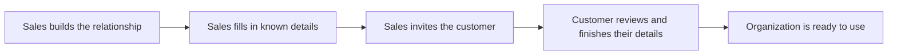

# From sales opportunity to organization onboarding

Status: Proposed. Delivery is tracked in [issue #2](https://github.com/milo-os/crm/issues/2).

Implementation proposal: [Native Milo API and system design](../design/opportunity-led-onboarding.md).

Give our sales team a simple way to manage customer relationships in Milo and help customers get started. Staff can track Companies, the People they’re talking with, and Opportunities, then invite a customer to set up their organization.

Sales fills in what they already know. The customer reviews those details, completes what’s missing, and gets immediate access.

## The journey

## Manage the relationship

Staff can create Companies, add People, and track Opportunities through the sales process. A Company can have multiple contacts and opportunities.

A Company will usually have one organization in Milo, but staff can link additional organizations when needed. Existing organizations and unfinished onboarding should be visible before staff start another.

## Prepare and invite

Staff with permission to manage onboarding can:

- Start onboarding at any Opportunity stage.
- Choose the person to invite and prefill known organization details.
- Choose whether the customer will pay by card or invoice.
- Review the details and send an email invitation.
- See progress, resend invitations, and cancel or replace them.

For the first version, one permission covers these actions. Staff prepare details before sending; after the invitation is sent, the customer makes any corrections.

## Choose the billing arrangement

Staff choose the billing arrangement before sending the invitation:

- **Pay by card:** The customer provides the required billing details and adds a payment method during onboarding.
- **Pay by invoice:** The customer confirms the required billing details without adding a payment method.

Only authorized staff can choose invoicing. Customers see the agreed arrangement and cannot change it themselves. Choosing invoicing provides the authorization needed; there is no additional manual review during onboarding.

The first version uses the billing service’s standard invoice terms. Custom payment terms and credit limits are outside CRM’s scope and are handled separately.

## Complete onboarding

The customer opens the invitation link, signs in or creates an account, and reviews the prepared details. They complete the required organization and billing details for their agreed billing arrangement and accept any required agreements themselves. They can save progress and return later.

The person who completes onboarding becomes the organization’s first administrator. The organization is ready to use immediately, with no separate manual review.

## Handle changes and follow-up

If someone else should complete onboarding, staff cancel the original invitation and send a replacement. The old link stops working. Saved organization details carry over, including customer corrections, while the new recipient completes their own account setup and agreements.

Resending or replacing an invitation continues the same onboarding and never creates another organization. Starting an additional organization is a separate, deliberate choice.

Staff manage follow-up using onboarding progress and the resend option. Automatic reminders are outside the first version. Expired or canceled invitation links give the customer a clear way to get help.

## Keep everyone informed

When onboarding finishes, Milo notifies the opportunity owner and shows completion on the Company and Opportunity. The organization remains linked to both.

The Opportunity’s stage stays unchanged, since completing onboarding and closing a sale may happen at different times.

## First-version checklist

- Staff can manage Companies, People, and Opportunities and see existing organizations and unfinished onboarding.
- Authorized staff can prepare details and invite a customer at any Opportunity stage.
- Customers can review and correct details, save progress, and complete the required onboarding details and agreements.
- Authorized staff choose card or invoice billing before sending. Card customers add a payment method; invoice customers complete billing details without a payment method or further manual review.
- Invoice billing uses the billing service’s standard terms; custom terms, credit limits, and customer changes to the billing arrangement are outside this flow.
- Completing onboarding gives the customer immediate access as the first administrator, without manual review.
- Resending or replacing an invitation continues the same onboarding. Replacement preserves saved organization details and disables the old invitation.
- Staff can follow progress and manage follow-up. Automatic reminders are outside the first version.
- Completion notifies the opportunity owner and connects the organization to the Company and Opportunity without changing the Opportunity stage.

Approving this enhancement agrees on the product direction. The tracking issue stays open until the functionality is delivered.
